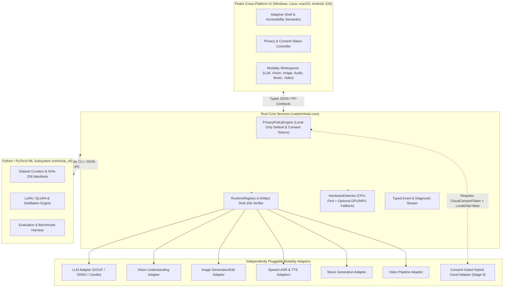

# MiniAI — System Architecture Specification (`ARCHITECTURE.md`)

**Document ID:** `MINIAI-ARCH-001`  
**Version:** `1.0.0`  
**Status:** `APPROVED`

---

## 1. Architectural Overview

MiniAI employs a **Tri-Layer Modular Architecture** designed for strict fault isolation, offline-first operation, CPU-first portability, and independently pluggable multimodal runtimes:

1. **Rust Core Layer (`crates/`)**:
   - Owns system configuration, privacy/consent policy enforcement (`PrivacyPolicyEngine`), hardware capability detection (`HardwareDetector`), model artifact integrity (`verify_sha256_digest`), runtime registry (`RuntimeRegistry`), local storage, and event streaming.
2. **Flutter Cross-Platform UI Layer (`ui/miniai_app/`)**:
   - Owns presentation across Windows, Linux, macOS, Android, and iOS.
   - Binds directly to typed contract models (`SystemSnapshot`, `HardwareProfile`, `RuntimeCapability`, `PrivacyPolicyState`), exposing zero unconnected or mock controls.
3. **Python/PyTorch ML Layer (`ml/`)**:
   - Owns dataset validation, LoRA/QLoRA fine-tuning, teacher-student distillation, evaluation benchmarks, and workspace governance verification (`miniai_ml`).



---

## 2. Independently Pluggable Modality Architecture

A core architectural invariant of MiniAI is that **unrelated model architectures are never forced into a single shared runtime**. Each modality implements the `ModalityAdapter` trait in Rust:

```rust
pub trait ModalityAdapter: Send + Sync {
    fn adapter_id(&self) -> &str;
    fn modality(&self) -> Modality;
    fn supported_backends(&self) -> Vec<AcceleratorBackend>;
    fn capability(&self) -> RuntimeCapability;
    fn health_check(&self) -> Result<AdapterHealth, MiniAiError>;
}
```

### Supported Modalities (`Modality` Enum)
- `Modality::Llm` — Text generation, chat completion, reasoning, code assistance (Stage 3).
- `Modality::Vision` — Image captioning, visual QA, OCR, object grounding (Stage 6).
- `Modality::ImageGeneration` — Text-to-image synthesis, inpainting, outpainting (Stage 6).
- `Modality::SpeechAsr` — Offline automatic speech recognition and diarization (Stage 7).
- `Modality::SpeechTts` — Neural text-to-speech synthesis and voice cloning (Stage 7).
- `Modality::Music` — Prompt-driven music and audio generation (Stage 7).
- `Modality::Video` — Temporal video understanding and video generation workflows (Stage 8).

---

## 3. CPU-First Execution & Hardware Fallback State Machine

1. **Discovery**: At startup, `HardwareDetector::detect_host_profile()` inspects CPU logical cores, system memory, and platform-specific accelerator availability.
2. **Admission Check**: Before loading any model weight artifact, `HardwareProfile::can_admit_model(required_bytes)` verifies that the model fits within safe memory limits (`<= 85%` of available memory).
3. **Backend Negotiation**:
   - If the user has forced `cpu_only = true` or no hardware accelerator is detected, `select_execution_backend` deterministically selects `AcceleratorBackend::Cpu`.
   - If an accelerator is selected and initialization fails at runtime, the supervisor catches the error, logs an audit event, and falls back to `AcceleratorBackend::Cpu`.

---

## 4. Privacy Policy & Consent Architecture

`PrivacyPolicyEngine` governs all compute and network boundaries:
- **State 1: `LocalOnlyPrivacyMode = true` (Default)**
  - All local CPU/GPU/NPU inference, local RAG, and local training are permitted.
  - All outbound cloud compute requests immediately fail closed with `MiniAiError::PrivacyModeBlocked`.
- **State 2: `LocalOnlyPrivacyMode = false`, No Consent Token**
  - Outbound cloud compute requests fail closed with `MiniAiError::ConsentRequired`.
- **State 3: `LocalOnlyPrivacyMode = false` + Valid `CloudConsentToken`**
  - Cloud compute is permitted **only** if `token.target_endpoint == requested_endpoint`, `token.modality == requested_modality`, `token.user_acknowledged == true`, and `current_epoch_secs < token.expires_at_epoch_secs`.

