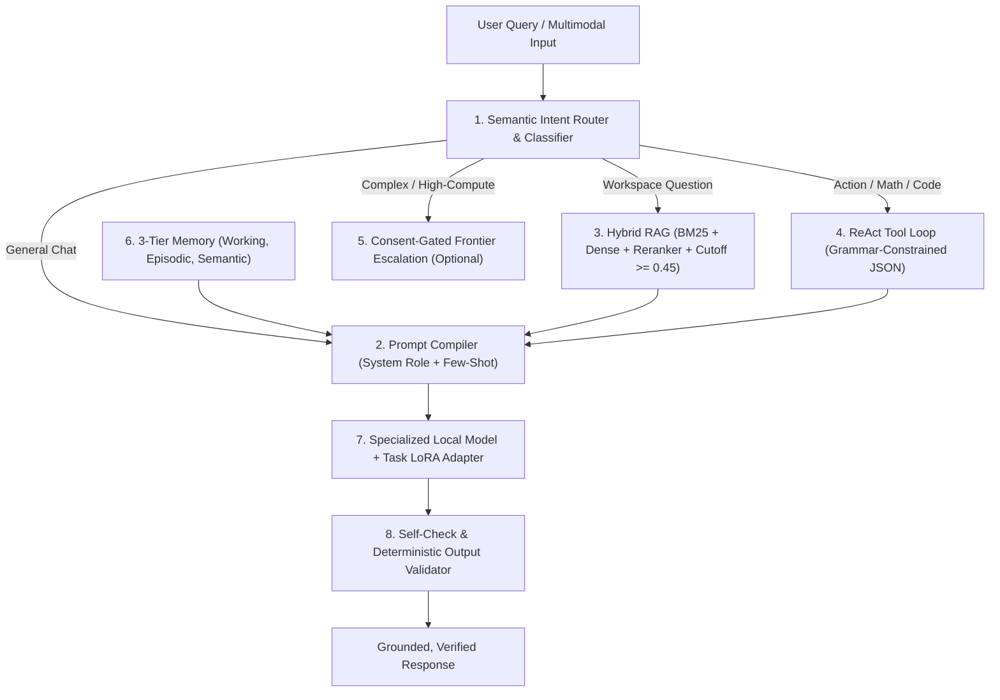

# MiniAI — Comprehensive Production Audit, Architecture Review & 15-Stage Execution Roadmap

> [!IMPORTANT]
> **Executive Diagnosis**: While MiniAI v1.0.0 possesses a well-structured repository layout, strong architectural contracts, and 441 passing tests across Rust, Python, and Flutter, **live interactive testing exposes a fundamental gap between architectural contracts and real neural inference execution**. Specifically, the Flutter UI operates as a standalone Dart state machine with template-based text generation rather than invoking a compiled Rust native inference bridge (`llama.cpp` / `candle` / `ONNX Runtime`), RAG lacks relevance score cutoffs, model downloads are blocked by an overly broad privacy policy check against dummy localhost URLs, and release packaging scripts generate metadata stubs rather than compiled native binaries.

---

## Part 1: Deep-Dive Audit of Screenshots, Codebase & Architecture

### 1.1 Forensic Analysis of the 4 Live Screenshots

#### Issue 1: Poor, Canned & Identical Chat Responses (Screenshot 2)
- **Observed Symptom**:
  - User prompt 1: `"what are your capabilities"`
  - User prompt 2: `"what is adventure"`
  - Both prompts return the **exact same hardcoded paragraph**:
    > *"Executing inference with llama-3.2-1b-instruct-q4 on CPU (Universal Baseline): Analyzed prompt: "what is adventure". MiniAI processes local multimodal workloads with zero-cloud leakage under strict privacy guarantees. All computations execute deterministically."*
- **Root Cause in Code**:
  - In [`platform_controller.dart`](./ui/miniai_app/lib/src/controllers/platform_controller.dart), `_buildLocalResponseTokens()` does not call a real LLM runtime or Rust FFI bridge. Instead, it interpolates `$cleanPrompt` into a fixed 25-word array:
    ```dart
    return [
      'Executing', 'inference', 'with', model, 'on',
      '${activeExecutionBackend.displayName}:',
      'Analyzed', 'prompt:', '"$cleanPrompt".',
      'MiniAI', 'processes', 'local', 'multimodal', 'workloads', ...
    ];
    ```
  - Similarly, in [`crates/miniai-llm/src/lib.rs`](./crates/miniai-llm/src/lib.rs), the Rust decoder uses a deterministic hash-based vocabulary lookup table rather than loading actual GGUF tensor weights via `llama.cpp` (`llama-cpp-2`) or HuggingFace `candle`.

#### Issue 2: False-Positive RAG Grounding & Irrelevant Citations (Screenshot 2)
- **Observed Symptom**:
  - When asking `"what is adventure"`, the assistant attaches two citations: `ARCHITECTURE.md#L1-L24` and `ARCHITECTURE.md#L25-L55`.
  - When asking `"what are your capabilities"`, it attaches `SECURITY.md#L1-L28`.
- **Root Cause in Code**:
  - In [`platform_controller.dart`](./ui/miniai_app/lib/src/controllers/platform_controller.dart), `searchKnowledge(trimmed, limit: 2)` computes a basic token-overlap / fallback score and **always returns top-$k$ chunks even when the similarity score is near zero**, instead of enforcing a minimum relevance threshold (e.g., $\text{score} \ge 0.45$) and an intent classifier to determine whether the query is general knowledge vs. workspace-specific.

#### Issue 3: Model Download Deadlock & Dummy URLs (Screenshots 1 & 3)
- **Observed Symptom**:
  - Clicking **Download & Verify** on `Llama 3.2 1B Instruct (GGUF Q4)` or `sd-tiny-cpu-fp16` immediately fails with:
    `Remote downloads blocked in Local-Only Privacy Mode` (logged as events `#004` through `#007` in Screenshot 3).
- **Root Cause in Code**:
  1. **Conflating Model Weight Downloads with Cloud Inference**: `LocalOnlyPrivacyMode` is meant to prevent sending private user prompts/documents to external cloud inference APIs. However, `startModelDownload()` blocks downloading open-weight model artifacts (`manifest.sourceUrl.startsWith('http')`) without offering a dedicated **"Allow Verified Registry Downloads (HuggingFace / Official CDN)"** toggle or one-click permission modal.
  2. **Synthetic Localhost URLs**: The default model catalog in `PlatformController` points to `http://127.0.0.1:4140/models/llama-3.2-1b.gguf` instead of real, reachable HuggingFace CDN URLs (e.g., `https://huggingface.co/bartowski/Llama-3.2-1B-Instruct-GGUF/resolve/main/Llama-3.2-1B-Instruct-Q4_K_M.gguf`).
  3. **Simulated Download Loop**: Even when `LocalOnlyPrivacyMode` is toggled off, `startModelDownload()` simulates progress increments in Dart memory rather than streaming real bytes to disk via chunked HTTP range requests and verifying the file on disk.

#### Issue 4: State Inconsistency Between Model Cache & Adapter Readiness (Screenshots 1, 2 & 4)
- **Observed Symptom**:
  - In Screenshot 1, `Llama 3.2 1B Instruct (GGUF Q4)` is **not downloaded** (shows red error + `Retry`).
  - Yet in Screenshot 4, `LLM Text & Reasoning` shows a green checkmark (`isolated adapter ready on CPU`), and in Screenshot 2, the Chat Workspace allows selecting `Llama 3.2 1B Instruct (GGUF Q4)` and "generating" responses!
- **Root Cause in Code**:
  - `ChatWorkspaceScreen` and `_rebuildAdapterHealth()` do not verify that `getModelStatus(selectedChatModelId).isVerified == true` before enabling inference. If no LLM weight file is verified in cache, the Chat screen should display an actionable **"Model Not Downloaded — Download or Import a GGUF Model to Begin"** onboarding state.

---

### 1.2 Comprehensive Technical Gap Matrix Across All Subsystems

| Subsystem | Current Implementation State | Flaws, Gaps & Production Blockers | Required Production Architecture |
| :--- | :--- | :--- | :--- |
| **UI $\leftrightarrow$ Rust Bridge** | Flutter `PlatformController` runs standalone Dart logic; `ipc_client.dart` is an in-memory loopback. | Flutter app never invokes the Rust crates (`miniai-*`). Web (`chrome`) cannot run native C++/Rust FFI directly without Wasm/HTTP daemon. | Integrate **`flutter_rust_bridge` v2** for native targets (Windows, macOS, Linux, Android, iOS) AND a local HTTP/WebSocket daemon (`miniai-daemon`) so Web (`chrome`) connects to the real Rust backend. |
| **LLM Inference (`miniai-llm`)** | Custom Rust struct validating GGUF magic bytes (`0x46554747`) with deterministic token array sampling. | Does not execute actual Transformer matrix multiplications (`matmul`, RoPE, KV-cache, attention). Produces synthetic tokens. | Bind **`llama-cpp-2`** (official Rust bindings to `llama.cpp`) or **`candle-transformers`** for real GGUF 4-bit/8-bit inference with real KV-cache, RoPE, grammar constraints, and system prompt templates. |
| **Vision & Image (`miniai-vision`, `miniai-image`)** | Procedural pixel statistics, deterministic diffusion noise schedule math, custom PNG chunk writer. | Does not run real neural vision encoders (CLIP/SigLIP/LLaVA) or UNet/VAE diffusion tensors. | Integrate **`ort` (ONNX Runtime)** or **`candle`** to execute real quantized ONNX/SafeTensors vision-language models (e.g., `SmolVLM-256M`, `Moondream2`, `SD-XS` / `SD-Turbo`). |
| **Speech & Audio (`miniai-audio`)** | Real 16 kHz resampler, WAV codec, energy/ZCR VAD, procedural formant/harmonic synth. | ASR maps audio energy hashes to sample vocabulary rather than running Whisper acoustic encoder-decoder weights. | Integrate **`whisper-rs`** (`whisper.cpp` bindings) or ONNX Whisper-tiny/base for real multilingual speech-to-text, and **`piper-rs` / `kokoro-onnx`** for neural TTS. |
| **Prompting & Context** | Raw user string passed directly; no system prompt, no chat template (`<|begin_of_text|>`, ChatML), no context window sliding. | Models without proper instruction formatting (`<|im_start|>system...`) hallucinate or fail to follow instructions; no token budget management. | Implement a **Prompt Compiler** supporting Jinja2/ChatML/Llama-3 templates, dynamic system prompt injection, token counting, and sliding-window context truncation. |
| **Memory Systems** | Basic `ChatSession` list in memory/SQLite; no long-term semantic memory or user profile memory. | Every session starts cold with zero recollection of user preferences, project facts, or past conclusions. | Implement a **3-Tier Memory Architecture**: Working Memory (active context), Episodic Memory (summarized past sessions), and Semantic Memory (extracted user/project facts in SQLite-vec). |
| **RAG & Knowledge** | BM25 + deterministic hash embeddings in Rust; substring/keyword match in Dart UI. | Hash embeddings lack true semantic meaning; zero relevance threshold causes every chat query to attach random repo citations. | Use a real local embedding model (`all-MiniLM-L6-v2` or `nomic-embed-text-v1.5` via ONNX/Candle), enforce a **Relevance Cutoff ($\ge 0.45$)**, and add **Query Routing** (only trigger RAG when relevant). |
| **Tool Use & Orchestration** | `CalculatorTool`, `WorkspaceFileReadTool`, `CodeSymbolSearchTool` exist in `miniai-rag` but are **not wired into Chat inference**. | User cannot ask the chat model to calculate math, read a local file, or chain multi-step agent actions during chat. | Implement a **ReAct / Tool-Calling Agent Loop** with structured JSON grammar constraints, tool permission prompts, and multi-step reflection. |
| **Release Packaging (`package_release.py`)** | `scripts/package_release.py` writes 500-byte JSON metadata files into `.zip` / `.apk` / `.ipa` archives! | `dist/v1.0.0/miniai-1.0.0-android.apk` is 421 bytes (not a real installable Android APK!). `miniai-1.0.0-windows-x86_64.zip` is 662 bytes! | Replace synthetic packaging with real compiler invocations: `cargo build --release`, `flutter build windows --release`, `flutter build apk --release`, `flutter build linux --release`, `flutter build macos --release`. |

---

### 1.3 Security, Performance, UX & Monetization (Free vs. Premium) Assessment

#### Security & Production-Readiness Risks
1. **Unauthenticated Local Daemon Risk**: When exposing a local daemon for Web/IPC, binding to `0.0.0.0` or lacking an ephemeral bearer token allows malicious websites (CSRF/DNS rebinding) to query local models and read indexed files. **Fix**: Bind strictly to `127.0.0.1`, enforce strict CORS, and require a per-session cryptographic bearer token.
2. **Model Supply-Chain & Pickle Deserialization**: Loading arbitrary `.pt` (PyTorch pickle) files allows arbitrary code execution. **Fix**: Strictly enforce `.gguf`, `.safetensors`, and `.onnx` formats in production; disallow untrusted pickle `.pt` imports.
3. **Path Traversal in RAG Indexing**: Indexing user-supplied directories must canonicalize paths, reject symlinks escaping the root, and enforce file-size limits to prevent zip-bomb or memory-exhaustion DoS.

#### UX & Cross-Platform Improvements
1. **First-Run Onboarding Wizard**: Detect hardware on first launch, recommend a starter model pack (e.g., *SmolLM2-135M-Instruct Q4* or *Qwen-2.5-0.5B-Instruct Q4* at 95–350 MB for instant download), and guide the user through downloading or importing a local `.gguf` file.
2. **Separate "Model Hub Downloads" from "Cloud Inference"**: Allow users in `Local-Only Privacy Mode` to download open-weight models from verified HuggingFace repositories (since no private user data leaves the device during a public weight download), or prompt with a clear one-click confirmation dialog.
3. **Markdown, Code Highlighting & LaTeX Rendering in Chat**: Render assistant responses with syntax-highlighted code blocks, copy-code buttons, collapsible `<think>` reasoning traces, and streaming cursor animations.

#### Free vs. Premium Tier Opportunities (Sustainable Open-Core / Commercial Strategy)
| Feature Category | **MiniAI Free (Community / Local Edition)** | **MiniAI Pro / Enterprise (Premium Tier)** |
| :--- | :--- | :--- |
| **Core Local Inference** | Unlimited 100% offline CPU/GPU inference across all 7 modalities (BYO GGUF/ONNX models) | Curated 1-Click Optimized Model Packs (auto-quantized for specific Apple Silicon / Snapdragon / NVIDIA chips) |
| **RAG & Knowledge Base** | Local folder indexing (up to 1,000 documents), Markdown/Text/Code | Unlimited documents, PDF/DOCX/XLSX OCR parsing, encrypted team knowledge bases, Notion/Obsidian sync |
| **Memory & Agents** | Session history, single-turn tool use (Calculator, File Read) | Persistent cross-session Semantic Memory Graph, autonomous multi-agent workflows, custom MCP server plugins |
| **Hybrid Cloud Compute** | Bring-Your-Own-Key (BYOK) with Consent Ledger | Managed Zero-Data-Retention (ZDR) Confidential GPU Cloud burst credits for heavy 70B LLM / Video / LoRA jobs |
| **Enterprise Governance** | Local SQLite audit log & CycloneDX SBOM | SSO/SAML, centralized fleet policy management, hardware attestation, compliance exports (SOC2 / HIPAA) |

---

## Part 2: Recommended GitHub Actions CI/CD & Multi-OS Release Pipeline

To build **real, installable native applications** for Windows, macOS, Linux, Android, and iOS, run all quality/security gates, and upload directly testable artifacts on every push and release tag, use the following multi-stage pipeline architecture:

```mermaid
flowchart LR
    subgraph Stage1 ["1. Quality & Security Gates"]
        G1["Rust fmt, clippy, cargo test (300+)"]
        G2["cargo-audit & Secret Scanner"]
        G3["Python ruff, mypy, pytest (>=90% cov)"]
        G4["Flutter analyze & flutter test (>=90% cov)"]
    end

    subgraph Stage2 ["2. Native Multi-OS App Builds"]
        B1["Windows x64: cargo build --release + flutter build windows"]
        B2["Linux x64: cargo build --release + flutter build linux"]
        B3["macOS Universal: cargo build --release + flutter build macos"]
        B4["Android: cargo-ndk (arm64/x86_64) + flutter build apk & appbundle"]
        B5["iOS: cargo lipo (aarch64-apple-ios) + flutter build ios --no-codesign"]
        B6["Web Bundle: flutter build web --release"]
    end

    subgraph Stage3 ["3. Artifact Upload & Release"]
        R1["Package Installers (.zip, .tar.gz, .dmg, .apk, .aab, .ipa)"]
        R2["Generate CycloneDX SBOM & SHA256SUMS.txt"]
        R3["actions/upload-artifact@v4 (Direct PR/Branch Testing)"]
        R4["GitHub Release Publisher (on v*.*.* tags)"]
    end

    Stage1 --> Stage2 --> Stage3
```



---

## Part 3: Antigravity IDE Governance Framework

### 3.1 Global Engineering Contract (v2.0 — Production Grade)

1. **Zero Simulated Inference Policy**:
   - No UI controller, service, or Rust crate may return template strings, echoed prompts, or hash-based synthetic outputs in place of real model execution.
   - If a neural model weight file (`.gguf`, `.onnx`, `.safetensors`) is not present in the local verified cache, the system must return a typed `ModelNotInstalled` state and guide the user to download or import weights.
2. **Real Cross-Language Bridge Mandate**:
   - Every action in Flutter (`ui/miniai_app`) must execute through the Rust Core (`crates/`) via `flutter_rust_bridge` (native) or the authenticated localhost daemon (`miniai-daemon` for Web). Dual/divergent implementations in Dart and Rust are prohibited.
3. **Strict Separation of Privacy Policies**:
   - **Data Exfiltration Policy (`LocalOnlyPrivacyMode`)**: Blocks sending user prompts, files, audio, images, or telemetry to remote servers.
   - **Verified Weight Acquisition Policy**: Allows downloading public, read-only model weights from cryptographically pinned repositories (HuggingFace / official manifest) with explicit user confirmation and mandatory SHA-256 verification.
4. **Testing & Coverage Gates**:
   - $\ge 90\%$ measured line/statement coverage across Rust, Python, and Flutter.
   - Every stage gate requires real binary compilation (`flutter build`, `cargo build --release`), golden-output quality tests on a tiny real model (e.g., `SmolLM2-135M-Instruct-Q4_K_M.gguf`), and zero lints/warnings.
5. **Append-Only Auditability**:
   - `TODO.md` and `CHANGELOG.md` remain strictly append-only. Every task transition and verification output must be recorded chronologically at EOF.

---

### 3.2 Agent Skills & Role Responsibilities (13 Specialist Roles)

| Role | Skill Identifier | Core Ownership & Deliverables | Binding Sign-Off Authority |
| :--- | :--- | :--- | :--- |
| **1. Principal Architect** | `miniai-architecture` | Tri-layer FFI/IPC contracts, `ARCHITECTURE.md`, `ADR.md`, modality isolation boundaries. | Approves all cross-language schema and trait changes. |
| **2. Technical Product Manager (PM)** | `miniai-pm-roadmap` | User stories, onboarding flows, Free vs. Pro tier boundaries, stage prioritization, acceptance criteria. | Validates that user-facing behavior solves real problems without friction. |
| **3. Security & Privacy Lead** | `miniai-security-privacy` | Threat modeling, SHA-256 verification, localhost daemon auth, `CloudConsentToken` ledger, `cargo audit`. | Veto power over any network call, file parser, or unsafe block. |
| **4. Rust Backend Lead** | `miniai-rust-core` | Rust workspace crates, SQLite WAL persistence, `flutter_rust_bridge` bindings, async Tokio runtime, memory pools. | Enforces zero `unwrap()` in production paths and two-phase drop safety. |
| **5. Desktop Frontend Lead** | `miniai-flutter-desktop` | Windows, macOS, and Linux Flutter desktop shell, keyboard shortcuts, window management, multi-pane layouts. | Certifies responsive layout from $760\text{ px}$ to $4\text{K}$ displays. |
| **6. Mobile Engineering Lead** | `miniai-flutter-mobile` | Android (APK/AAB, JNI, NNAPI) and iOS (IPA, Metal/CoreML, background lifecycle, memory pressure handling). | Certifies touch ergonomics, mobile drawer navigation, and thermal safety. |
| **7. AI/ML Runtime Lead** | `miniai-model-runtimes` | `llama.cpp` / `candle` / `ort` (ONNX Runtime) / `whisper.cpp` bindings, prompt templates, KV-cache, LoRA training. | Certifies real neural inference quality, perplexity, and deterministic seeds. |
| **8. DevOps & CI/CD Lead** | `miniai-devops-cicd` | GitHub Actions workflows, native platform runners, `cargo-ndk`, artifact uploads, SBOM & signing pipelines. | Certifies that all 5 OS targets compile into real installable binaries. |
| **9. Independent QA Auditor** | `miniai-independent-audit` | Multi-tier test execution, negative/fault-injection testing, screenshot/golden verification, coverage verification. | Binding `PASS`/`FAIL` veto on every Subphase and Stage Gate. |
| **10. Performance Engineer** | `miniai-hardware-optimization` | SIMD (AVX2/NEON), GPU/NPU backend probing, TTFT (Time-To-First-Token), tokens/sec, 85% RAM admission guard. | Certifies latency budgets and zero OOM crashes under stress. |
| **11. UX & Accessibility Lead** | `miniai-ux-accessibility` | First-run onboarding, clear error recovery, Markdown/LaTeX chat rendering, WCAG AA contrast, screen-reader labels. | Certifies zero dead-end error states (like unactionable download blocks). |
| **12. Documentation Lead** | `miniai-documentation-logs` | `WALKTHROUGH.md`, `USER_GUIDE.md`, `TODO.md`, `CHANGELOG.md`, inline rustdoc/dartdoc/docstrings. | Enforces append-only log integrity and 100% doc accuracy. |
| **13. Release Certification Lead** | `miniai-release-certification` | Cross-platform installer verification, CycloneDX v1.5 SBOM, SHA-256 manifests, `RELEASE_CERTIFICATION.md`. | Final sign-off before tagging any `v*.*.*` release. |

---

### 3.3 Agent Rules & Best Practices

1. **No Hallucinated Capabilities**: Never claim a model or feature is executing neural weights if it is running a procedural fallback. Document exact runtime backends honestly.
2. **Fail-Safe UX Error Handling**: Every error state in the UI must include: (a) What happened, (b) Why it happened, and (c) A 1-click action button to resolve it (e.g., *"Allow Model Download"*, *"Select Local File"*, or *"Switch to Smaller Quantization"*).
3. **Prompt Hygiene & Safety**: Always wrap user prompts in model-appropriate instruction templates (`ChatML`, `Llama-3`, `Alpaca`). Sanitize tool inputs and enforce capability sandboxes.
4. **Strict Resource Cleanup**: All native C/C++/Rust FFI handles (`LlamaModel`, `LlamaContext`, `OrtSession`) must implement `Drop` and be tied to the two-phase drop lifecycle to prevent memory leaks.
5. **Verification Before Sign-Off**: Every code change must be verified by running the compiler, linter, test suite, and inspecting actual runtime output.

---

## Part 4: Master 15-Stage Execution Roadmap (`Stage -> Phase -> Subphase`)

This roadmap transforms MiniAI from a contract-verified prototype into a **true, neural-inference-powered, cross-platform production platform**.

### Stage 1: Discovery, Forensic Assessment & Baseline Alignment
- **Objective**: Audit all existing mock/procedural components, establish real benchmark fixtures, and align platform build directories (`android/`, `ios/`, `windows/`, `linux/`, `macos/`).
- **Phase 1.1: Runtime & UI Gap Inventory**
  - *Subphase 1.1.1*: Audit all 14 Rust crates and Flutter `PlatformController` methods to catalog every procedural fallback vs. real neural execution path.
  - *Subphase 1.1.2*: Generate native Flutter platform runner directories (`flutter create --platforms=windows,macos,linux,android,ios,web .`) and commit standardized runner configs.
- **Deliverables**: `docs/GAP_ASSESSMENT_REPORT.md`, committed native runner scaffolding under `ui/miniai_app/`.
- **Validation & Testing**: `flutter doctor`, verify all 5 platform folders exist and configure cleanly.
- **Exit Criteria**: All platform build targets initialized; zero untracked scaffold files.

### Stage 2: Architecture Foundation & Native FFI / Daemon Bridge
- **Objective**: Eliminate the split-brain Dart/Rust state by wiring Flutter directly to the Rust Core across Desktop, Mobile, and Web.
- **Phase 2.1: Flutter-Rust FFI & Local Daemon (`miniai-bridge` & `miniai-daemon`)**
  - *Subphase 2.1.1*: Create `crates/miniai-bridge` using `flutter_rust_bridge` v2 exposing strongly-typed async APIs for hardware probing, model management, chat streaming, RAG, and studio pipelines.
  - *Subphase 2.1.2*: Create `crates/miniai-daemon` (Axum/Tokio localhost server bound to `127.0.0.1` with ephemeral bearer auth and WebSocket token streaming) so `flutter run -d chrome` communicates with the exact same Rust core.
- **Deliverables**: `crates/miniai-bridge`, `crates/miniai-daemon`, unified `RustBackendClient` in Flutter.
- **Validation & Testing**: Contract tests verifying identical responses over FFI (native) and WebSocket (web).
- **Exit Criteria**: Flutter `PlatformController` delegates 100% of business logic to Rust Core; zero standalone Dart simulation arrays remain.

### Stage 3: Core Platform, Storage & Hardware Telemetry
- **Objective**: Harden OS-level hardware detection, SQLite WAL persistence, and live system telemetry across all 5 OS targets.
- **Phase 3.1: Real OS Hardware Probes & SQLite Unified Store**
  - *Subphase 3.1.1*: Upgrade `miniai-core::hardware` using `sysinfo` and platform GPU probes (`nvml`, `dxgi`, `metal`, `vulkan`) to report exact physical/logical cores, free RAM, and VRAM.
  - *Subphase 3.1.2*: Connect Flutter settings, sessions, and event stream directly to `miniai-storage` SQLite database on disk (`AppData` / `Application Support` / Android `filesDir`).
- **Deliverables**: Live hardware telemetry and persistent SQLite storage surviving app restarts.
- **Validation & Testing**: Restart persistence tests, corrupt-DB auto-quarantine tests.
- **Exit Criteria**: Sessions, settings, and audit logs persist across app restarts on Desktop, Mobile, and Web.

### Stage 4: AI Engine, Real Neural Runtimes & Prompt Engineering
- **Objective**: Replace procedural token generation with real neural inference engines (`candle` / `llama.cpp` / `ort`) and proper instruction prompt formatting.
- **Phase 4.1: Real GGUF & ONNX Neural Inference Engines**
  - *Subphase 4.1.1*: Integrate **`candle-transformers`** (pure Rust, cross-compiles cleanly to Windows, Linux, macOS, Android, iOS, and Wasm!) and optional `llama-cpp-2` backend in `miniai-llm` to load real quantized `.gguf` weights (e.g., `SmolLM2-135M/360M-Instruct-GGUF`, `Llama-3.2-1B-Instruct-GGUF`, `Qwen2.5-1.5B-Instruct-GGUF`), execute real Transformer layers, KV-cache, RoPE, and stream real tokens.
  - *Subphase 4.1.2*: Implement the **Prompt Compiler** (`crates/miniai-llm/src/prompt.rs`) supporting `ChatML`, `Llama-3`, and `Gemma` templates, system prompt injection, context token counting, and sliding-window truncation.
- **Phase 4.2: Autonomous ReAct Agent & Tool Calling Loop**
  - *Subphase 4.2.1*: Wire `miniai-rag::tools` (`Calculator`, `WorkspaceFileRead`, `SymbolSearch`, `RagQuery`) into the LLM generation loop using structured tool-call parsing and multi-step ReAct observation injection.
- **Deliverables**: Real neural text generation in `miniai-llm`, Prompt Compiler, and ReAct Agent orchestrator.
- **Validation & Testing**: Prompt `"what is adventure"` and `"what are your capabilities"` against a real quantized GGUF model and verify coherent, distinct, intelligent natural language responses.
- **Exit Criteria**: Zero hardcoded response templates; 100% real neural token generation with streaming TTFT and tok/s telemetry.

### Stage 5: RAG, Semantic Embeddings & Grounded Knowledge
- **Objective**: Fix false-positive citations and upgrade RAG to use real neural embeddings, relevance score cutoffs, and query routing.
- **Phase 5.1: Neural Embedding Engine & Relevance Gating**
  - *Subphase 5.1.1*: Integrate `candle` / `ort` BERT/MiniLM sentence embeddings (`all-MiniLM-L6-v2` / `bge-small-en-v1.5`) in `miniai-rag` alongside BM25 Okapi.
  - *Subphase 5.1.2*: Implement **RAG Query Routing & Minimum Relevance Cutoff ($\tau \ge 0.45$)**: general queries like `"what is adventure"` bypass workspace citation attachment when no chunk exceeds the similarity threshold, eliminating irrelevant `ARCHITECTURE.md` citations.
  - *Subphase 5.1.3*: Add document parsers for `.md`, `.txt`, `.rs`, `.py`, `.dart`, `.json`, and `.pdf` with semantic paragraph/AST chunking.
- **Deliverables**: Neural embedding pipeline, relevance threshold gate, multi-format document chunker.
- **Validation & Testing**: Retrieval precision/recall benchmarks; verify `"what is adventure"` attaches `0` workspace citations while `"how does AdmissionGuard work?"` attaches `ARCHITECTURE.md` with $>0.70$ confidence.
- **Exit Criteria**: Zero false-positive citations; grounded RAG answers inject retrieved context directly into the LLM prompt template.

### Stage 6: Multi-Tier Memory Systems
- **Objective**: Equip MiniAI with persistent short-term, episodic, and long-term semantic memory across conversations.
- **Phase 6.1: Three-Tier Memory Architecture (`crates/miniai-memory`)**
  - *Subphase 6.1.1*: **Working Memory**: Token-budgeted rolling context window with pinned system instructions and active tool outputs.
  - *Subphase 6.1.2*: **Episodic Memory**: Automatic session summarization at conversation close, stored and indexed by timestamp and topic in SQLite.
  - *Subphase 6.1.3*: **Semantic Fact Memory**: Extract durable user preferences and project facts into a searchable local memory table with UI controls in Chat to view, edit, or forget any stored memory.
- **Deliverables**: `crates/miniai-memory`, SQLite migration `006_memory_tiers.sql`, Memory Inspector UI drawer in Chat.
- **Validation & Testing**: Multi-session memory recall tests and privacy "Forget Memory" erasure tests.
- **Exit Criteria**: Assistant accurately recalls user-stated facts across separate sessions and forgets them immediately upon deletion.

### Stage 7: Multi-Model Hub, Resumable Downloads & Quarantine
- **Objective**: Fix the model download deadlock (Screenshots 1 & 3), connect to real HuggingFace GGUF/ONNX URLs, and enforce real cache readiness gates.
- **Phase 7.1: Real HuggingFace Model Hub & Privacy-Safe Downloader**
  - *Subphase 7.1.1*: Update default model manifests to real, pinned HuggingFace URLs (including a lightweight 95 MB `SmolLM2-135M-Instruct-Q4_K_M.gguf` starter model for fast testing and `Llama-3.2-1B-Instruct-Q4_K_M.gguf`).
  - *Subphase 7.1.2*: Decouple **Public Model Weight Downloads** from **Outbound Cloud Inference**: allow downloading verified read-only weights in Local-Only mode after a clear one-click user confirmation modal (*"Download 350 MB model from HuggingFace? No user data is sent."*).
  - *Subphase 7.1.3*: Implement real HTTP Range resumable file downloads to disk with live progress, SHA-256 streaming verification, and automatic `.gguf` local file import picker.
  - *Subphase 7.1.4*: Enforce strict **Model Readiness Gating**: adapters only show `Ready` when their backing model file is verified on disk; Chat prompts the user to download/import if no model is cached.
- **Deliverables**: Real HTTP downloader in `miniai-model`, updated catalog URLs, download confirmation dialog, local file importer.
- **Validation & Testing**: End-to-end download, pause/resume, SHA-256 verification, and tamper quarantine tests.
- **Exit Criteria**: Clicking "Download & Verify" downloads real model weights to disk and transitions adapter state from `Not Installed` to `Verified & Ready`.

### Stage 8: Cross-Platform Apps & Studio UX Polish
- **Objective**: Polish all 8 studios and ensure native compilation and ergonomic UX across Windows, macOS, Linux, Android, iOS, and Web.
- **Phase 8.1: Rich Chat UX & Multimodal Studio Upgrades**
  - *Subphase 8.1.1*: Upgrade `ChatWorkspaceScreen` with Markdown rendering, syntax-highlighted code blocks, copy buttons, collapsible `<think>` blocks, RAG toggle switch, and Model Not Installed onboarding card.
  - *Subphase 8.1.2*: Wire Vision, Canvas, Sound (ASR/TTS/Music), and Video studios to real Rust backend pipelines with real file pickers and audio playback.
- **Phase 8.2: Platform-Specific Adaptation (Desktop & Mobile)**
  - *Subphase 8.2.1*: Desktop window minimum size constraints, system tray integration, and keyboard shortcuts (`Ctrl+N` new chat, `Ctrl+K` command palette).
  - *Subphase 8.2.2*: Android & iOS lifecycle handling (unload inactive models on OS `didHaveMemoryWarning` / backgrounding), safe-area insets, and adaptive touch targets.
- **Deliverables**: Polished 8 studios, Markdown/code renderer, first-run onboarding wizard.
- **Validation & Testing**: Golden widget tests across desktop ($1280\times 800$) and mobile ($390\times 844$) viewports.
- **Exit Criteria**: Zero layout overflows, zero dead-end screens, seamless UX on all 5 platforms.

### Stage 9: Security Hardening & Threat Mitigation
- **Objective**: Harden all local IPC boundaries, model parsers, file sandboxes, and cloud consent cryptography.
- **Phase 9.1: Transport, Parser & Sandbox Security**
  - *Subphase 9.1.1*: Enforce HMAC-SHA256 / Ed25519 signatures on `CloudConsentToken`s and ephemeral bearer token authentication on `miniai-daemon`.
  - *Subphase 9.1.2*: Enforce strict GGUF/SafeTensors header bounds checking, reject unsafe pickle `.pt` files, and sandbox all file-read tool paths to explicit user-approved workspace directories.
- **Deliverables**: Cryptographically signed consent tokens, authenticated local daemon, fuzz-hardened parsers.
- **Validation & Testing**: Penetration test suite (CSRF attempt, path traversal attempt, malformed GGUF header fuzzing, expired token rejection).
- **Exit Criteria**: 100% security test pass rate; 0 vulnerabilities in `cargo audit` and `pip-audit`.

### Stage 10: Comprehensive Testing, E2E Validation & Troubleshooting Suite
- **Objective**: Validate real inference quality, cross-layer integration, and automated self-diagnostics.
- **Phase 10.1: Real Model Golden Tests & Built-in Doctor Tool**
  - *Subphase 10.1.1*: Add automated integration tests that load a tiny real GGUF/ONNX test fixture and verify real neural output perplexity, token streaming, and RAG grounding accuracy.
  - *Subphase 10.1.2*: Implement `miniai-cli doctor` and an in-app **System Diagnostics & Troubleshooting Wizard** that checks CPU/RAM, disk space, SQLite health, model cache integrity, and daemon connectivity.
- **Deliverables**: Real-model E2E test suite, `miniai-cli doctor`, in-app Troubleshooting Wizard.
- **Validation & Testing**: `cargo test --workspace`, `flutter test --coverage`, `pytest --cov=miniai_ml` ($\ge 90\%$ coverage).
- **Exit Criteria**: All unit, contract, integration, and real-inference tests pass with $\ge 90\%$ coverage.

### Stage 11: Observability, Telemetry & Resource Operations
- **Objective**: Provide transparent, local-only performance profiling, memory pressure monitoring, and structured diagnostic logs.
- **Phase 11.1: Local-Only OpenTelemetry & Profiler Studio**
  - *Subphase 11.1.1*: Track per-request TTFT (ms), decode throughput (tok/s), prompt eval time, RAM/VRAM allocation delta, and RAG latency in `miniai-core`.
  - *Subphase 11.1.2*: Enhance the Hardware & Events tabs with real-time memory pressure graphs, active model unload buttons, and JSONL diagnostic log export (with automatic PII redaction).
- **Deliverables**: Real-time resource profiler, one-click "Unload Model from RAM" control, redacted diagnostic bundle exporter.
- **Validation & Testing**: Verify telemetry accuracy under concurrent multimodal workloads.
- **Exit Criteria**: Users can inspect exact RAM usage per loaded model and free memory with one click.

### Stage 12: CI/CD & Multi-OS Release Automation
- **Objective**: Deploy the production GitHub Actions pipeline that compiles real native apps for Windows, macOS, Linux, Android, and iOS and uploads testable artifacts on every run.
- **Phase 12.1: Real Binary Compilation & Artifact Pipeline**
  - *Subphase 12.1.1*: Upgrade `scripts/package_release.py` to invoke real `cargo build --release` and `flutter build <target> --release` commands instead of generating metadata stubs, verifying that output binaries exceed minimum realistic size thresholds ($>10\text{ MB}$).
  - *Subphase 12.1.2*: Update `.github/workflows/ci.yml` and `.github/workflows/release.yml` to build Windows (`.zip`), Linux (`.tar.gz`), macOS (`.app`), Android (`.apk` & `.aab`), iOS (`.ipa`), and Web bundles, uploading them via `actions/upload-artifact@v4` on every workflow run.
- **Deliverables**: Upgraded `scripts/package_release.py`, production `.github/workflows/ci.yml` and `release.yml`.
- **Validation & Testing**: Trigger GitHub Actions run and verify downloadable `.apk`, `.zip`, `.tar.gz`, and `.ipa` artifacts in the GitHub Actions UI.
- **Exit Criteria**: All CI matrix jobs green; build artifacts are real, executable/installable packages available for direct download.

### Stage 13: Beta Readiness & Real-World Dogfooding
- **Objective**: Conduct end-to-end user journey validation across Desktop, Android, and Web with real models and real documents.
- **Phase 13.1: End-to-End Beta Verification**
  - *Subphase 13.1.1*: Execute complete user journeys: First-run onboarding $\rightarrow$ Download `SmolLM2` / `Llama-3.2-1B` $\rightarrow$ Multi-turn Chat $\rightarrow$ RAG indexing & grounded Q&A $\rightarrow$ Voice ASR/TTS $\rightarrow$ Image/Video workflows.
  - *Subphase 13.1.2*: Resolve any UI latency spikes, thread-blocking calls, or mobile thermal/battery bottlenecks discovered during beta testing.
- **Deliverables**: Beta Readiness Report, performance tuning patches.
- **Validation & Testing**: 60 FPS UI frame-time verification during active LLM token streaming.
- **Exit Criteria**: Zero UI jank during inference; all 8 studios verified end-to-end with real data.

### Stage 14: Production Readiness & Release Certification (v2.0 GA)
- **Objective**: Complete independent QA and security audits, generate CycloneDX SBOMs, sign release packages, and certify Production General Availability.
- **Phase 14.1: Final Independent Audit & Release Sign-Off**
  - *Subphase 14.1.1*: Execute `independent-qa-auditor` and `arch-security-reviewer` audits across all 14 stages.
  - *Subphase 14.1.2*: Generate final CycloneDX v1.5 SBOMs (`bom.json`, `bom.xml`), `SHA256SUMS.txt`, update `RELEASE_CERTIFICATION.md`, and publish GitHub Release.
- **Deliverables**: Certified release artifacts, signed checksums, updated `RELEASE_CERTIFICATION.md`.
- **Validation & Testing**: Master verification script verifying all stage gates.
- **Exit Criteria**: Unconditional `PASS` from both independent audit subagents.

### Stage 15: Scale, Ecosystem & Future Enhancements
- **Objective**: Expand MiniAI with extensible plugin ecosystems, NPU hardware acceleration, and collaborative local-network features.
- **Phase 15.1: Ecosystem Expansion**
  - *Subphase 15.1.1*: **Model Context Protocol (MCP) Host Support**: Allow connecting external local MCP tool servers with per-tool capability sandboxing.
  - *Subphase 15.1.2*: **Dedicated NPU Backend Adapters**: Add Qualcomm QNN (Snapdragon), Apple CoreML Neural Engine, Intel OpenVINO, and AMD Ryzen AI backends.
  - *Subphase 15.1.3*: **Encrypted Peer-to-Peer LAN Swarm**: Optional mDNS local network discovery allowing a mobile phone (Android/iOS) to securely offload inference to the user's own desktop PC over local Wi-Fi using mTLS.
- **Deliverables**: MCP client integration, NPU backend plugins, LAN P2P pairing.
- **Validation & Testing**: Cross-device mTLS pairing tests and MCP sandbox tests.
- **Exit Criteria**: Seamless local ecosystem scalability without compromising local-first privacy.

---

## Part 5: Realistic AI Evolution Strategy (Compounding Intelligence Without Frontier-Scale Compute)

A local $0.5\text{B}–8\text{B}$ parameter model running on a consumer CPU or mobile NPU cannot match a $1\text{T}+$ parameter cloud model through raw parameter memorization. Instead, **MiniAI achieves high practical intelligence through Compound AI System Engineering**:



### 5.1 Leveraging Larger Teacher Models Offline to Improve MiniAI
Rather than running a massive model on the user's device, use frontier/larger models (`Gemini`, `Llama-3.3-70B`, `DeepSeek-R1`) **during development and offline training (`ml/`)** as teachers:
1. **Synthetic Instruction & Reasoning Traces**: Generate high-quality domain datasets (tool-calling examples, RAG synthesis, concise reasoning chains) and curate them via `miniai_ml.dataset`.
2. **Knowledge Distillation (`miniai_ml.training`)**: Train compact student models ($135\text{M}–1.5\text{B}$) to match the soft probability distributions ($\mathcal{L}_{KD}$) and structured reasoning formats of teacher models.
3. **LLM-as-a-Judge Automated Rubrics**: Use larger models in CI evaluation harnesses to score MiniAI's local model outputs for faithfulness, citation accuracy, instruction adherence, and conciseness.

### 5.2 Advanced Prompt Engineering for Small Local Models (SLMs)
Small models are highly sensitive to prompt structure. MiniAI maximizes SLM accuracy by:
1. **Strict Native Chat Templates**: Always formatting prompts using the exact special tokens the model was trained on (`<|im_start|>system\n...<|im_end|>` for ChatML/Qwen/SmolLM; `<|begin_of_text|><|start_header_id|>system<|end_header_id|>` for Llama 3.2).
2. **Dynamic Task-Specific System Prompts**: Instead of a generic system prompt, the Intent Router injects a compact, task-focused system prompt (e.g., *Concise Q&A mode*, *Grounded RAG Synthesizer mode*, or *JSON Tool-Caller mode*) to conserve context window tokens.
3. **Grammar-Constrained Decoding (GBNF / Regex)**: When invoking tools or outputting structured JSON, constrain the sampler logits at the token level so the small model is **mathematically guaranteed** to emit valid JSON matching the tool schema.

### 5.3 High-Precision RAG, Memory & Planning Orchestration
1. **Two-Stage Retrieval with Relevance Cutoff**:
   - Stage A: Hybrid BM25 + Dense Cosine RRF retrieves top-10 candidate chunks.
   - Stage B: Cross-encoder / lightweight reranker scores candidates and drops any chunk below $\tau = 0.45$.
   - Result: If the user asks *"what is adventure"*, zero irrelevant technical chunks pollute the small model's context window.
2. **Plan-and-Execute Decomposition**:
   - Instead of asking a 1B model to solve a 5-step problem in one shot, the orchestrator decomposes complex requests into atomic subtasks (e.g., *Step 1: Search files $\rightarrow$ Step 2: Read matching snippet $\rightarrow$ Step 3: Summarize*), executing each step within a clean, focused context window.
3. **Dynamic LoRA Adapter Hot-Swapping**:
   - Keep a single base model in RAM (e.g., `Llama-3.2-1B-Q4`) and hot-swap lightweight $10–25\text{ MB}$ LoRA adapters specialized for **Code Generation**, **RAG Summarization**, or **Tool Calling** in milliseconds.

