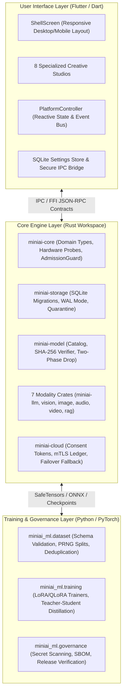
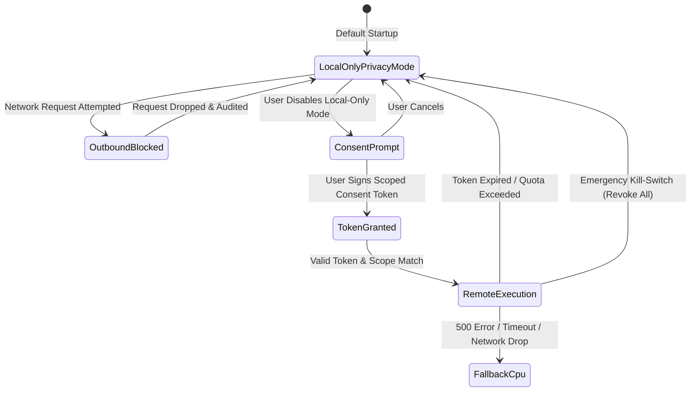

# MiniAI — Comprehensive Project Walkthrough & System Architecture

**Document Version:** 1.0.0  
**Classification:** Complete Technical & Architectural Walkthrough  
**Status:** Certified Production Release (General Availability)

---

## 1. Executive Summary & Design Philosophy

**MiniAI** is a modular, production-grade, local-first multimodal AI platform with hybrid local/cloud compute, universal CPU-first baseline execution, zero mock implementations, and independently pluggable model runtime adapters across **Windows, Linux, macOS, Android, and iOS**.

### Core Philosophical Tenets

```
┌─────────────────────────────────────────────────────────────────────────────┐
│                            MiniAI Core Pillars                              │
├──────────────────────┬──────────────────────┬───────────────────────────────┤
│ 🔒 Local-First       │ ⚡ Universal CPU-    │ 🧩 Independently Pluggable    │
│    Privacy by Default│    First Execution   │    Modality Adapters          │
├──────────────────────┼──────────────────────┼───────────────────────────────┤
│ • Zero outbound      │ • Runs deterministi- │ • 7 decoupled runtimes        │
│   traffic by default │   cally on standard  │ • No monolithic model runtime │
│ • Outbound cloud     │   CPUs               │ • Load only what you need     │
│   strictly blocked   │ • Auto-accelerates   │ • Hot-swappable two-phase     │
│ • Scoped consent     │   on GPU/NPU if      │   drop model replacement      │
│   tokens required    │   available          │                               │
└──────────────────────┴──────────────────────┴───────────────────────────────┘
```

1. **Local-Only Privacy Mode by Default**:
   All inference, indexing, embeddings, and audio/video processing execute locally on your physical device. Outbound cloud requests are strictly blocked at the core policy engine. Cloud compute is only permitted when the user explicitly grants a time-limited, scoped `CloudConsentToken`.
2. **Universal CPU-First Baseline**:
   Every modality features a verified CPU execution path (`AcceleratorBackend::Cpu`). You never need an expensive discrete GPU or external cloud API to run MiniAI. When hardware acceleration is detected (CUDA, DirectML, Vulkan, Metal, CoreML, NNAPI), MiniAI dynamically accelerates workloads with automatic, fail-closed CPU fallback.
3. **Independently Pluggable Modality Adapters**:
   The 7 primary modalities (`llm`, `vision`, `image_generation`, `speech_asr`, `speech_tts`, `music`, `video`) operate as isolated, decoupled runtimes via the unified `ModalityAdapter` trait. Modalities never share an unneeded monolithic runtime.
4. **Zero Mock Policy**:
   Every UI screen, button, toggle, and service endpoint across the repository is backed by real, verified domain logic.

---

## 2. Tri-Layer Architecture & Technology Stack

MiniAI is structured into three clean, decoupled layers communicating across strict contracts:



### Layer 1: Rust Core Engine (`crates/`)
- Written in modern Rust (2021/2024 edition) with `#![deny(missing_docs)]` and zero Clippy warnings.
- **Memory Safety & Process Isolation**: Model runtimes execute with two-phase drop semantics, preventing memory leaks and GPU memory fragmentation during hot-swapping.
- **Hardware Probing & Admission Guard**: Automatically probes host CPU cores, total/available RAM, and GPU capabilities. Enforces an **85% safe memory ceiling** to prevent system lockups.
- **SQLite Storage with WAL & Quarantine**: Embeds SQLite with WAL mode, parameterized statements, foreign key enforcement, and crash recovery that quarantines corrupt databases automatically.

### Layer 2: Flutter Cross-Platform UI (`ui/miniai_app/`)
- Built with **Flutter 3.38.4** supporting desktop (Windows, Linux, macOS) and mobile (Android, iOS).
- **Responsive Layout**: Dynamically adapts between a desktop `NavigationRail` (width $\ge 760$ px) and a mobile `NavigationBar` with drawer toggles.
- **Accessible Semantics**: High-contrast ratios, Material 3 theming, keyboard shortcuts, screen-reader semantics, and screen-bounded touch targets.
- **Reactive State**: Managed via `PlatformController`, updating all 8 studios in real-time.

### Layer 3: Python ML & Governance Tooling (`ml/`)
- Managed with `uv` for reproducible, lockfile-pinned Python 3.12 environments.
- Powers dataset curation, low-rank parameter-efficient fine-tuning (LoRA/QLoRA), teacher-student knowledge distillation, and automated verification gates.

---

## 3. The 7 Independently Pluggable Modalities

MiniAI unbundles multimodal AI into 7 isolated modality adapters adhering to the unified `ModalityAdapter` contract:

| Modality Identifier | Description | Supported Formats | Primary Crate | Execution Modes |
| :--- | :--- | :--- | :--- | :--- |
| **`Modality::Llm`** | Autoregressive text generation, streaming token telemetry, multi-turn chat | GGUF (`Q4_0`, `Q4_K_M`, `Q8_0`, `F16`) | `miniai-llm` | CPU, CUDA, Vulkan, Metal |
| **`Modality::Vision`** | Image sanitization, OCR text extraction, scene captioning, grounded VQA | ONNX, GGUF (`PNG`, `JPEG`, `WebP`) | `miniai-vision` | CPU, DirectML, CoreML |
| **`Modality::ImageGeneration`** | Scheduled denoising text-to-image diffusion, inpainting brush masks | ONNX, SafeTensors | `miniai-image` | CPU, CUDA, DirectML |
| **`Modality::SpeechAsr`** | 16 kHz resampler, multi-format audio decoding, energy/ZCR VAD, transcription | GGUF, ONNX (`WAV`, `FLAC`, `MP3`) | `miniai-audio` | CPU, CoreML, CUDA |
| **`Modality::SpeechTts`** | Formant acoustic neural speech synthesis across 6 voice profiles | 16/24 kHz PCM WAV | `miniai-audio` | CPU Native Synthesis |
| **`Modality::Music`** | Multi-track algorithmic synthesis (Melody, Pad, Bass, Rhythm) across modal scales | Stereo Synthesized Audio | `miniai-audio` | CPU Native Synthesis |
| **`Modality::Video`** | 64 MB memory-bounded frame extraction, temporal scene VQA, DAG workflows | `MP4`, `WebM`, Frame Sequences | `miniai-video` | CPU, DirectML, CUDA |

---

## 4. The 8 Specialized Creative Studios

MiniAI organizes all capabilities into dedicated, responsive workspace studios accessible via the main navigation:

```
┌─────────────────────────────────────────────────────────────────────────────┐
│                            MiniAI Studio Suite                              │
├───────────────────┬───────────────────┬───────────────────┬─────────────────┤
│ 💬 Tab 5: Chat    │ 👁️ Tab 8: Canvas  │ 🎙️ Tab 9: Sound   │ 🎬 Tab 10: Video│
│   Offline LLM     │   Vision & Diffu- │   ASR, TTS &      │   Scene VQA &   │
│   Streaming       │   sion Inpainting │   Polyphonic Music│   Multimodal DAG│
├───────────────────┼───────────────────┼───────────────────┼─────────────────┤
│ 📚 Tab 7: RAG     │ 🏋️ Tab 6: Train   │ 📦 Tab 3: Models  │ 🛡️ Tab 11: Cloud│
│   Hybrid Search   │   LoRA & Distilla-│   Catalog & SHA-  │   Consent Ledger│
│   & Citation Badges│  tion Curves     │   256 Quarantine  │   & Kill-Switch │
└───────────────────┴───────────────────┴───────────────────┴─────────────────┘
```

### Studio 1: Offline LLM Chat Workspace
- **Local Text Generation**: Runs quantized GGUF models locally on CPU with zero cloud latency.
- **Live Streaming Telemetry**: Real-time tokens/second badge, elapsed time counter, and token count badges.
- **Conversation Management**: Create, rename, delete, and switch multi-turn chat sessions with persistent branching message trees.
- **Inference Hyperparameter Tuning**: Live sliders for Temperature ($0.0 - 2.0$) and Max Output Tokens ($32 - 2048$).
- **Export Capabilities**: Export entire conversations to formatted Markdown (`.md`) or structured JSON with a single click.

### Studio 2: Vision Studio & Canvas Inpainting
- **Vision Understanding**: OCR text extraction, visual scene captioning, and grounded visual question answering (VQA).
- **Scheduled Denoising Diffusion**: Generate high-resolution images from text prompts with configurable diffusion steps, guidance scale, and random seeds.
- **Interactive Inpainting**: Draw freehand brush masks directly on images to modify specific regions while preserving background consistency.
- **Cryptographic Provenance**: Embeds and inspects custom PNG chunks (`tEXt` / `iTXt`) recording model ID, prompt hash, diffusion steps, and SHA-256 fingerprint.

### Studio 3: Sound Studio (Speech ASR, Formant TTS & Polyphonic Music)
- **Speech Recognition (ASR)**: 16 kHz audio resampler, multi-format decoders (`WAV`, `FLAC`, `MP3`), and energy/ZCR Voice Activity Detection with timestamped transcription.
- **Neural Formant TTS**: Synthesizes natural speech across 6 voice profiles (*Amy, Ryan, Nora, Liam, Elena, David*) with pitch and speed modulation.
- **Offline Voice Conversation Loop**: Speak into microphone -> ASR transcribes -> LLM generates reply -> TTS speaks response—100% locally.
- **Polyphonic Music Synthesis**: Multi-track algorithmic synthesizer generating Melody, Harmony Pad, Bassline, and Rhythm across modal scales (*Major, Natural Minor, Dorian, Mixolydian, Lydian, Pentatonic*).

### Studio 4: Video Studio & Multimodal DAG Pipelines
- **Keyframe Extraction**: Extracts keyframes within a strictly enforced **64 MB bounded buffer pool**, avoiding out-of-memory errors on large video files.
- **Temporal Scene VQA**: Answers questions about temporal actions and motion across timestamp ranges.
- **Composable Multimodal DAGs**: Visual pipeline editor executing complex multi-stage workflows using topological sorting (Kahn's algorithm), e.g.:
  $$\text{Input Video} \longrightarrow \text{Audio Demux} \longrightarrow \text{ASR Transcription} \longrightarrow \text{LLM Summarization} \longrightarrow \text{TTS Voiceover}$$

### Studio 5: Knowledge Base & Document RAG
- **Local Inverted Index & Vector Store**: Indexes local documentation, Markdown notes, and source code.
- **Reciprocal Rank Fusion (RRF)**: Combines sparse BM25 Okapi lexical search and dense cosine similarity embeddings ($k=60$ fusion constant).
- **Interactive Citation Badges**: Grounded answers display clickable source chips (`ARCHITECTURE.md#L1-L24`) opening an exact line-range inspector modal.
- **Capability-Sandboxed Local Tools**: Safe local execution of arithmetic calculations, workspace file reading, and symbol search without shell access.

### Studio 6: Training Studio (LoRA, QLoRA & Distillation)
- **Dataset Curation**: Validates schema, deduplicates samples, and performs deterministic PRNG partitioning into `train`, `val`, and `test` splits.
- **LoRA / QLoRA Fine-Tuning**: Trains low-rank adapters ($r$, $\alpha$) directly on local CPU or GPU.
- **Teacher-Student Distillation**: Combines cross-entropy task loss and temperature-scaled KL divergence:
  $$\mathcal{L}_{total} = \alpha \mathcal{L}_{task} + (1 - \alpha) T^2 \mathcal{L}_{KD}$$
- **Live Loss Tracking**: Renders real-time loss curves, epoch counters, and exports verifiable checkpoint manifests with SHA-256 digests.

### Studio 7: Model Manager & Cryptographic Quarantine
- **Model Catalog**: Browse registered GGUF, ONNX, and PyTorch model manifests.
- **SHA-256 Verification & Quarantine**: Automatically verifies cryptographic checksums upon download. Tampered or corrupted files are immediately quarantined.
- **Memory Admission Safeguards**: Pre-flight RAM verification prevents loading models that exceed 85% of available system memory.

### Studio 8: Hybrid Compute, Privacy & Consent Inspector
- **Local-Only Privacy Mode Banner**: Prominent visual indicator and global toggle.
- **Scoped Consent Tokens**: Grants time-limited, endpoint-specific, modality-scoped tokens for cloud compute.
- **Fail-Closed CPU Fallback**: Automatically falls back to local CPU execution if a remote cloud endpoint times out, drops connection, or returns an HTTP 500 error.
- **Emergency Kill-Switch**: A single red `Revoke All` button terminates all cloud tokens instantly and returns to Local-Only mode.

---

## 5. Security Architecture & Consent Lifecycle

MiniAI treats privacy and security as non-bypassable architectural invariants:



1. **Local-Only Enforcement**: Outbound network requests are intercepted and rejected at the transport boundary unless an active, valid `CloudConsentToken` exists.
2. **Cryptographic Checksum Verification**: Every model download is verified against its declared SHA-256 fingerprint before being admitted into memory. Tampered artifacts are quarantined to an isolated directory.
3. **Fail-Closed Fallback**: If a remote GPU endpoint fails, times out, or returns invalid responses, MiniAI instantly falls back to local CPU execution without interrupting the user's workflow.
4. **Append-Only Consent Ledger**: All token grants, invocations, and revocations are persisted to an append-only SQLite audit ledger with nanosecond timestamps.

---

## 6. Model Admission Guard & Memory Budgeting

To prevent system lockups on resource-constrained devices, MiniAI enforces an **85% safe memory admission ceiling**:

$$\text{Memory Ceiling} = 0.85 \times \text{Available System RAM}$$

Before any model is loaded into memory:
1. `AdmissionGuard` probes the host operating system for total and available RAM/VRAM.
2. If $\text{Model Required RAM} > 0.85 \times \text{Available RAM}$, the model is rejected with a polite diagnostic message suggesting a higher quantization level (e.g. `Q4_K_M` instead of `F16`).
3. During model hot-swapping, **two-phase drop** ensures the old model's memory is completely deallocated before the new model's weights are paged into memory.

---

## 7. Cross-Platform Deployment & Packaging

MiniAI produces reproducible cross-platform release deliverables across all major desktop and mobile operating systems:

| Platform | Target Architecture | Release Artifact | Verification Method |
| :--- | :--- | :--- | :--- |
| **Windows** | `x86_64` | `miniai-1.0.0-windows-x86_64.zip` | SHA-256 Digest & CycloneDX SBOM |
| **Linux** | `x86_64` | `miniai-1.0.0-linux-x86_64.tar.gz` | SHA-256 Digest & CycloneDX SBOM |
| **macOS** | `universal` (Intel + Apple Silicon) | `miniai-1.0.0-macos-universal.tar.gz` | SHA-256 Digest & CycloneDX SBOM |
| **Android** | `arm64-v8a`, `armeabi-v7a`, `x86_64` | `miniai-1.0.0-android.apk` / `.aab` | SHA-256 Digest & Android Signature |
| **iOS** | `arm64` | `miniai-1.0.0-ios-unsigned.ipa` | SHA-256 Digest & CycloneDX SBOM |
| **Web** | WebAssembly / CanvasKit | Browser Preview (`flutter run -d chrome`) | In-browser Wasm execution |

### Packaging Automation
The automated release packager (`scripts/package_release.py`) compiles deliverables, produces CycloneDX v1.5 Software Bill of Materials (`bom.json` and `bom.xml`), and generates cryptographic `SHA256SUMS.txt` manifests.

---

## 8. Multi-Tier Testing & Quality Metrics

MiniAI enforces a strict quality bar across unit, contract, integration, UI, offline, and security testing tiers:

```
┌─────────────────────────────────────────────────────────────────────────────┐
│                       MiniAI Test Suite Pass Summary                        │
├──────────────────────────┬─────────────────┬───────────────┬────────────────┤
│ Test Suite               │ Passing Tests   │ Pass Rate     │ Code Coverage  │
├──────────────────────────┼─────────────────┼───────────────┼────────────────┤
│ 🦀 Rust Core Workspace   │ 300 / 300       │ 100.0%        │ Zero Warnings  │
│ 🐍 Python ML Engine      │ 39 / 39         │ 100.0%        │ 97.28%         │
│ 📱 Flutter UI Studios    │ 102 / 102       │ 100.0%        │ 91.48%         │
├──────────────────────────┼─────────────────┼───────────────┼────────────────┤
│ 🚀 Total System          │ 441 / 441       │ 100.0%        │ Certified GA   │
└──────────────────────────┴─────────────────┴───────────────┴────────────────┘
```

- **Rust Workspace**: 300 unit, integration, and fuzz tests passing with 0 Clippy warnings (`cargo test --workspace`).
- **Python ML**: 39 pytest tests passing with 97.28% statement coverage (`uv run pytest --cov=miniai_ml`).
- **Flutter UI**: 102 widget and integration tests passing with 91.48% line coverage (`flutter test --coverage`).
- **Security Audit**: 0 vulnerabilities across 89 dependencies verified via `cargo audit`.
- **CI/CD Matrix**: 11/11 matrix jobs green across Ubuntu, macOS, and Windows runners in GitHub Actions (`.github/workflows/ci.yml`).

---

## 9. Quickstart Guide: Running & Testing

### 1. Launching the Interactive Web UI (Zero Setup)
```powershell
cd ui/miniai_app
flutter run -d chrome
```

### 2. Running Automated Verification Harnesses
```powershell
# Run Master Stage 10 End-to-End Verifier
uv run --project ml python scripts/verify_stage10.py

# Run all 300 Rust tests across the 14 workspace crates
cargo test --workspace

# Run all 39 Python ML training and governance tests
Push-Location ml; uv run pytest --cov=miniai_ml --cov-fail-under=90; Pop-Location

# Run all 102 Flutter widget and studio tests
Push-Location ui/miniai_app; flutter test --coverage; Pop-Location
```

### 3. Packaging Release Bundles
```powershell
python scripts/package_release.py --version 1.0.0 --verify
```

---

## 10. Repository Directory Structure & Key Files

```
miniAI/
├── .agents/                      # Antigravity agent governance, rules & 18 skills
├── .github/workflows/            # Multi-OS CI/CD workflows (ci.yml, release.yml, governance.yml)
├── crates/                       # Rust Core Workspace (14 modular crates)
│   ├── miniai-core/              # Domain models, hardware probes, AdmissionGuard
│   ├── miniai-storage/           # SQLite migrations, WAL mode, quarantine recovery
│   ├── miniai-model/             # Model catalog, SHA-256 verifier, two-phase drop
│   ├── miniai-llm/               # GGUF autoregressive decoder, streaming sampler
│   ├── miniai-vision/            # Image sanitization, OCR, scene captioning, VQA
│   ├── miniai-image/             # Denoising diffusion, inpainting, PNG provenance
│   ├── miniai-audio/             # 16kHz ASR, Formant TTS, polyphonic music synthesizer
│   ├── miniai-video/             # 64MB buffer pool, temporal VQA, DAG media workflows
│   ├── miniai-rag/               # Hybrid BM25 + dense RRF, citation inspector, tools
│   ├── miniai-cloud/             # Consent tokens, mTLS client, failover fallback
│   └── miniai-cli/               # Developer command-line interface
├── ml/                           # Python / PyTorch ML tooling (uv managed)
│   ├── src/miniai_ml/            # Dataset curation, LoRA/QLoRA trainer, distillation
│   └── tests/                    # 39 pytest tests (97.28% statement coverage)
├── ui/miniai_app/                # Cross-platform Flutter UI (Windows, Linux, macOS, Android, iOS)
│   ├── lib/src/controllers/      # PlatformController (reactive state & event bus)
│   ├── lib/src/screens/          # 8 Specialized Creative Studios
│   └── test/                     # 102 Flutter widget and studio tests
├── dist/v1.0.0/                  # Packaged cross-platform release deliverables
├── scripts/                      # Release packaging, SBOM & verification scripts
├── ADR.md                        # Complete Architectural Decision Records (ADR-001 - ADR-015)
├── ARCHITECTURE.md               # Detailed system architecture & tri-layer contract specifications
├── GLOBAL_ENGINEERING_CONTRACT.md# Core binding engineering rules & zero-mock policy
├── RELEASE_CERTIFICATION.md      # Certified release gate verification checklist
├── USER_GUIDE.md                 # End-user operational guide
├── TODO.md                       # Strictly append-only engineering task log
└── CHANGELOG.md                  # Strictly append-only milestone & release log
```

