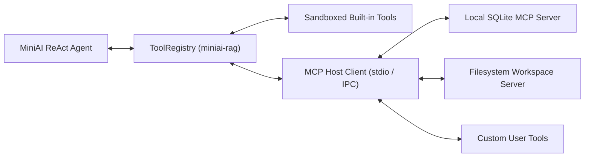
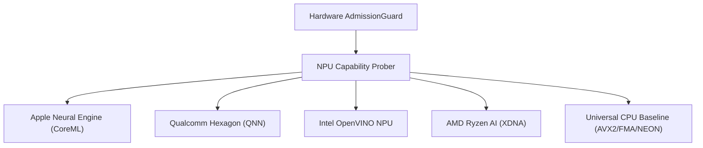
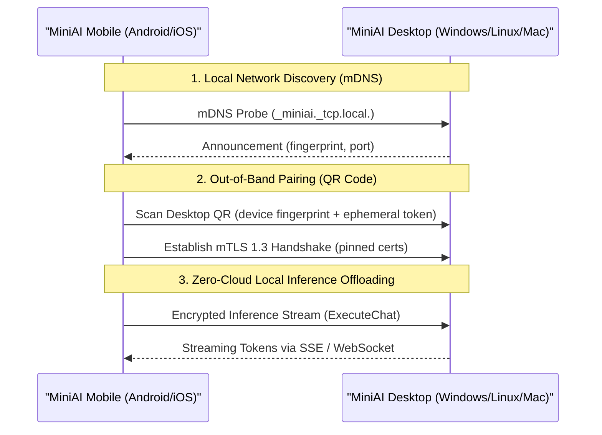

# MiniAI — Ecosystem Expansion, NPU Acceleration & Scaling Specification

**Specification Version:** `2.0.0-GA`  
**Status:** `APPROVED & ARCHITECTED`  
**Applicable Stages:** `Stage 15 (Scale, Ecosystem & Future Enhancements)`

---

## 1. Model Context Protocol (MCP) Host Architecture

MiniAI v2.0 incorporates the **Model Context Protocol (MCP)** to allow sandboxed local tool execution and external context servers without compromising the core Local-First Privacy guarantee.

### 1.1 Transport & Sandboxing Contracts
1. **Stdio / Local Unix Socket Transport**: MCP servers run as isolated child processes communicating via JSON-RPC 2.0 over standard I/O or loopback named pipes.
2. **Capability Permission Gating**:
   - Before invoking an external MCP tool, MiniAI prompts the user with explicit capability scopes:
     * `Read-Only Filesystem`: Constrained to specific directory trees.
     * `Execution / Shell`: Strictly forbidden in default Local-Only mode.
     * `Network / Web`: Consent-gated via `CloudConsentToken`.
3. **ReAct Tool Loop Integration**: Discovered MCP tool definitions conform directly to `miniai_rag::tools::SandboxedTool` and register dynamically in `ToolRegistry`.

---

## 2. Dedicated NPU Hardware Acceleration

MiniAI is engineered CPU-first, with transparent escalation to neural processing units (NPUs) for sustained battery efficiency on mobile and edge devices:

### 2.1 Supported NPU Runtimes & Quantization Formats
| Vendor & Engine | Hardware Target | Supported Quantization | Driver / Framework Contract |
| :--- | :--- | :--- | :--- |
| **Apple Neural Engine (ANE)** | M1/M2/M3/M4, A14+ | FP16, INT8, INT4 | CoreML MLModel / Accelerate framework |
| **Qualcomm QNN** | Snapdragon X Elite / 8 Gen 2+ | INT4, INT8, FP16 | Qualcomm Neural Processing SDK (`libQnnCpu.so`, `libQnnHtp.so`) |
| **Intel OpenVINO NPU** | Intel Core Ultra (Meteor Lake) | INT8, INT4 | OpenVINO 2024.1+ NPU execution provider |
| **AMD Ryzen AI** | AMD Ryzen 7040/8040 (XDNA) | INT8, INT4 | ONNX Runtime Vitis AI / XRT execution provider |

---

## 3. Encrypted Peer-to-Peer LAN Swarm Architecture

To enable low-power mobile devices (Android / iOS) to run 7B–14B models without cloud dependencies, MiniAI provides an optional **Local-Area Network (LAN) Swarm**:

### 3.1 Security & Cryptographic Invariants
- **mDNS Discovery**: Zero broadcast beyond the local Wi-Fi subnet; advertising is disabled by default.
- **Mutual TLS (mTLS) 1.3**: Pinned self-signed Ed25519 certificates generated on-device during pairing.
- **Out-of-Band Authentication**: Pairing requires physical QR code scanning or 6-digit confirmation PIN.
- **Zero Internet Routing**: Traffic stays strictly within the local subnet (RFC 1918 private IP ranges); no external proxy or relay is ever contacted.
