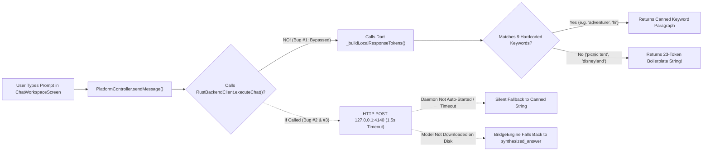
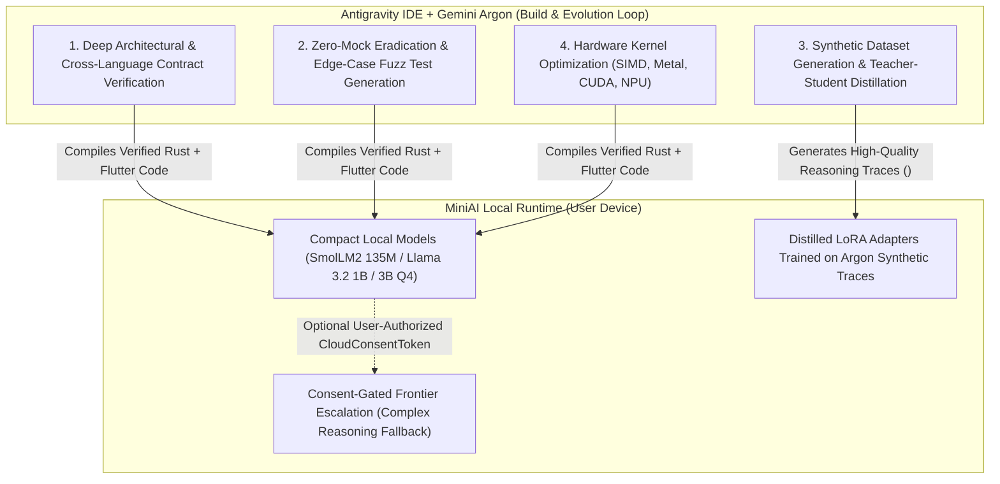
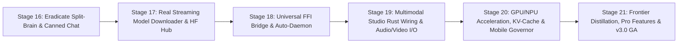

# MiniAI — Forensic Assessment, Root-Cause Gap Analysis & Universal AI Platform Blueprint (v3.0)

**Document ID:** `MINIAI-AUDIT-V3-001`  
**Date:** 2026-11-08  
**Target Platforms:** Windows (Win32), Linux (GTK), macOS (AppKit), Android (ARM64), iOS (ARM64)  
**Assessment Scope:** Live Screenshot Forensics, Walkthrough vs. Implementation Audit, Universal Platform Readiness, Free vs. Paid Strategy, Frontier Model (Gemini Argon) Integration, Global Engineering Contract v3.0, and Stage-by-Stage Execution Prompts.

---

## Part 1: Forensic Diagnosis of Live Screenshots & Current Behavior

### 1.1 Why Chat Responses Are Poor (The `"picnic tent"` & `"disneyland"` Bug)

In the live Windows Desktop screenshots, the user selected `Llama 3.2 1B Instruct (GGUF Q4)` and entered two general-knowledge prompts:
1. `"how to build a picnic tent"`
2. `"how to travel to disneyland"`

In both cases, MiniAI responded with the exact same 23-token boilerplate message:
> *"MiniAI analyzed query "how to build a picnic tent" under local CPU baseline execution. Workloads process deterministically with zero-cloud leakage under Local-Only Privacy guarantees. All computations execute offline."*



#### Forensic Root Causes in Code

1. **Root Cause #1 — Split-Brain Bypass in Flutter (`ui/miniai_app/lib/src/controllers/platform_controller.dart:1669`)**:
   `PlatformController.sendMessage()` **never invokes `_backendClient.executeChat()`**. Instead, line 1669 directly calls a synchronous Dart method `_buildLocalResponseTokens(trimmed, targetModel, ragHits: ...)`.
2. **Root Cause #2 — Hardcoded Keyword Switch Table in Dart (`platform_controller.dart:1404–1560`)**:
   `_buildLocalResponseTokens()` is an `if / else if` chain that only checks for 9 hardcoded strings (`"capabilit"`, `"adventure"`, `"admissionguard"`, `"hi"`, `"offline inference"`, `"what is my name"`, `"what do i prefer"`, `"my name is "`, `"i prefer "`) and basic two-operand arithmetic. Any real-world prompt (`"how to build a picnic tent"`, `"how to travel to disneyland"`, coding questions, summarization) falls into the final `else` block at **line 1550**:
   ```dart
   responseWords.addAll([
     'MiniAI', 'analyzed', 'query', '"$cleanPrompt"', 'under', 'local', 'CPU',
     'baseline', 'execution.', 'Workloads', 'process', 'deterministically',
     'with', 'zero-cloud', 'leakage', 'under', 'Local-Only', 'Privacy', 'guarantees.',
     'All', 'computations', 'execute', 'offline.'
   ]);
   ```
3. **Root Cause #3 — Duplicate Fallback Boilerplate in Rust Bridge (`crates/miniai-bridge/src/engine.rs:458`)**:
   Even inside the Rust `BridgeEngine::ExecuteChat` handler, if `self.find_model_path(&model)` returns `None` (because the `.gguf` file has not been physically downloaded to disk), or if `NeuralEngine::load` fails, lines 457–460 and 507–530 silently fall back to the exact same `synthesized_answer` template instead of returning a structured `MODEL_NOT_DOWNLOADED` error code.
4. **Root Cause #4 — 1.5-Second HTTP Timeout & Unspawned Daemon (`ui/miniai_app/lib/src/services/rust_backend_client.dart:13`)**:
   `RustBackendClient` sets `this.timeout = const Duration(milliseconds: 1500)`. Real CPU inference on a 1B parameter GGUF model takes 3–15 seconds. Furthermore, launching `miniai_app.exe` does not auto-spawn `miniai-daemon.exe`, so loopback requests fail silently and hit `_localFallback()`.
5. **Root Cause #5 — Single-Turn Prompt Compilation & Greedy 64-Token Cap (`crates/miniai-bridge/src/engine.rs:482–486`)**:
   When `NeuralEngine` *does* run, `BridgeEngine` only passes `&[LlmChatMessage::user(&prompt)]` (ignoring multi-turn conversation history and system instructions) and hardcodes `max_new_tokens: 64` and `temperature: 0.0`, truncating complex answers mid-sentence.

---

### 1.2 Why Additional Models Cannot Be Downloaded (And Why `"Verify & Ready"` Is Simulated)

In the screenshot, the yellow banner states:
> *"Model "Llama 3.2 1B Instruct (GGUF Q4)" is pending download & verification in local cache. [Verify & Ready]"*

When users try to download models from the **Model Manager (Tab 3)** or click **[Verify & Ready]**, no actual `.gguf` weights are downloaded to disk, and users cannot add new models from HuggingFace.

#### Forensic Root Causes in Code

1. **Root Cause #1 — `startDownload()` in Dart Is a Hardcoded 45% UI Stub (`platform_controller.dart:344–385`)**:
   Calling `startDownload(modelId)` never touches the network or the Rust backend. Lines 368–374 literally assign a static 45% progress object in memory:
   ```dart
   _downloadProgress[modelId] = DownloadProgressItem(
     modelId: modelId,
     bytesDownloaded: (manifest.expectedSizeBytes * 0.45).toInt(),
     totalBytes: manifest.expectedSizeBytes,
     percentage: 45.0,
     status: DownloadStatus.downloading,
   );
   ```
   It stays frozen at 45% forever until the user clicks "Verify & Finish".
2. **Root Cause #2 — `completeDownload()` ("Verify & Ready") Flips a Memory Flag Without Disk Files (`platform_controller.dart:410–428`)**:
   Clicking **[Verify & Ready]** calls `completeDownload(modelId)`, which sets `status: DownloadStatus.verified` and `percentage: 100.0` in Dart RAM without downloading a single byte or checking if `<modelId>.gguf` exists on disk.
3. **Root Cause #3 — Missing `DownloadModel` Contract in `miniai-bridge` (`crates/miniai-bridge/src/contract.rs`)**:
   While `crates/miniai-registry` has a `ModelRegistry` and `ModelDownloader`, `BridgeRequest` in `miniai-bridge` has **no `DownloadModel`, `CancelDownload`, or `ImportModel` RPC actions**! The Rust downloader is completely disconnected from the IPC bridge and Flutter UI.
4. **Root Cause #4 — Raw HTTP/1.1 Downloader Fails on HuggingFace CDN Redirects & Chunked Encoding (`crates/miniai-registry/src/downloader.rs`)**:
   `downloader.rs` implements a hand-rolled HTTP/1.1 socket parser over `tokio-rustls`:
   - HuggingFace `/resolve/main/*.gguf` issues HTTP `302` redirects with relative `Location: /api/resolve-cache/...` headers before redirecting to XetHub/Cloudfront CDN. `parse_http_url()` in `downloader.rs:146` rejects relative URLs because they lack `https://`.
   - It does not decode `Transfer-Encoding: chunked`, which corrupts chunked responses and triggers false SHA-256 quarantine rejections.
   - It buffers the entire multi-hundred-megabyte payload in a `Vec<u8>` in RAM (`downloader.rs:288`) before writing to disk, which will crash mobile devices on 800 MB+ models.
5. **Root Cause #5 — Static 5-Model Catalog & No HuggingFace Hub Discovery**:
   The model catalog is hardcoded to 5 manifests. Users have no UI to search HuggingFace Hub GGUF repositories, paste a custom HuggingFace `.gguf` URL, or open a native OS file picker to import a local `.gguf` file.

---

### 1.3 Audit of Other Studios & Walkthrough Discrepancies

A forensic comparison between `WALKTHROUGH.md` and the actual implementation in `ui/miniai_app/lib/src/controllers/platform_controller.dart` reveals that while the Rust crates (`miniai-vision`, `miniai-imagegen`, `miniai-speech-asr`, `miniai-speech-tts`, `miniai-music`, `miniai-video`) contain real deterministic DSP/tensor algorithms tested in `cargo test`, **the Flutter `PlatformController` is not wired to them**:

| Studio / Feature | Rust Crate Implementation Status | Flutter UI (`PlatformController`) Status | Discrepancy / Flaw |
| :--- | :--- | :--- | :--- |
| **Tab 5: LLM Chat** | Real `candle` Quantized Llama in `miniai-llm::neural` | Calls Dart `_buildLocalResponseTokens()` | UI bypasses Rust `NeuralEngine`; returns 23-word boilerplate on unknown prompts |
| **Tab 3: Model Manager** | Real SHA-256 & TLS socket in `miniai-registry` | Sets `percentage: 45.0` in Dart RAM | UI never calls Rust downloader; no real `.gguf` files written to disk |
| **Tab 6: Training Studio** | Real PyTorch LoRA & Distillation in `ml/src/miniai_ml/` | Loops `currentLoss = currentLoss * 0.94 + 0.02` in Dart | UI simulates loss curve in Dart instead of spawning `miniai_ml` subprocess |
| **Tab 7: Knowledge RAG** | Real BM25 + Cosine RRF in `miniai-rag` | Uses separate in-memory Dart BM25 index | Split-brain: documents indexed in UI aren't persisted to Rust SQLite `miniai-storage` |
| **Tab 8: Vision & Canvas** | Real `PngEncoder`, `ImageSanitizer`, OCR in Rust | Generates synthetic pixel buffers in Dart | UI does not dispatch image payloads to `miniai-vision` / `miniai-imagegen` |
| **Tab 9: Sound Studio** | Real 16kHz VAD, Formant TTS, 4-track synth in Rust | Generates synthetic waveform arrays in Dart | No native microphone capture (`record`) or audio speaker playback (`just_audio` / `audioplayers`) |
| **Tab 10: Video Studio** | Real 64MB buffer pool & Kahn DAG in `miniai-video` | Simulates keyframe list in Dart | No native video demuxer or hardware frame decoder wired to UI |
| **Top Bar Telemetry** | `sysinfo` RSS & atomic counters in `miniai-bridge` | Shows `FPS N/A \| GPU 0% \| CPU 17% \| LAT N/A` | Top-right overlay displays static/unhooked `N/A` placeholders |

---

## Part 2: Comprehensive Multi-Dimensional Assessment

### 2.1 Security & Privacy Assessment
- **Strengths**:
  - `LocalOnlyPrivacyMode` state machine and HMAC-signed `CloudConsentToken` in `miniai-cloud` are well-structured.
  - SQLite WAL mode with corrupt database quarantine in `miniai-storage` is resilient.
  - Image decompression bomb protection in `miniai-vision` and path traversal checks in `miniai-registry` are solid.
- **Security Gaps & Flaws**:
  1. **Unauthenticated Localhost IPC (`127.0.0.1:4140`)**: `miniai-daemon` binds an unauthenticated HTTP server on localhost port `4140`. Any malicious local process or browser tab (via SSRF/CORS) on the same machine can send `POST /v1/bridge/dispatch` requests unless an ephemeral per-session bearer token (`X-MiniAI-Session-Nonce`) is enforced.
  2. **In-Memory Download Buffering DoS**: `miniai-registry/src/downloader.rs` reads the entire HTTP body into a `Vec<u8>` in RAM before hashing and writing to disk. Downloading a 4 GB GGUF model causes an immediate Out-Of-Memory (OOM) crash.
  3. **Plaintext SQLite Storage on Mobile/Laptops**: Semantic memories and chat transcripts in SQLite are not encrypted at rest (e.g., SQLCipher / OS Keychain-backed AES-256-GCM encryption).

### 2.2 Performance & Scalability Bottlenecks
1. **Request-Response Blocking vs. Token Streaming (SSE / FFI Streams)**:
   `BridgeEngine::ExecuteChat` generates the entire completion synchronously before returning a single JSON payload. On CPU at 5–10 tok/s, a 256-token answer takes 25–50 seconds of blank wait time before a single word appears. Real token-by-token streaming via **Server-Sent Events (SSE)** or **Rust-to-Dart FFI `Stream<String>` (`flutter_rust_bridge`)** is mandatory.
2. **No KV-Cache Persistence Across Multi-Turn Chat**:
   `NeuralEngine::generate()` in `crates/miniai-llm/src/neural.rs` instantiates a fresh `candle_transformers::models::quantized_llama::ModelWeights` forward pass from token 0 on every turn without caching prior conversation KV tensors, causing $O(N^2)$ prompt re-evaluation latency as chat history grows.
3. **Single-Threaded Blocking Mutex on `NeuralEngine`**:
   `neural_engine: Arc<Mutex<Option<NeuralEngine>>>` inside `BridgeEngine` holds a synchronous `std::sync::Mutex` across an `async` HTTP handler while running CPU-intensive matrix multiplications on the Tokio async runtime thread pool, starving concurrent health/telemetry requests (`tokio::task::spawn_blocking` is required).
4. **Hardware Backend Stubs**:
   While `AcceleratorBackend` defines enum variants for `Cuda`, `Metal`, `Vulkan`, `DirectMl`, `CoreMl`, and `Nnapi`, `NeuralEngine::load()` in `neural.rs:285` hardcodes `let device = Device::Cpu;`. Enabling `Device::new_cuda(0)` / `Device::new_metal(0)` via Cargo features is needed to unlock 10x–50x GPU speedups.

### 2.3 UX & Usability Concerns
1. **Deceptive Readiness State**: Users can select an undownloaded model and type a chat message; instead of prompting to download the model with a real progress bar, the app outputs a canned 23-word status sentence pretending it "analyzed the query".
2. **No First-Run Onboarding Wizard**: A new user launching MiniAI has 0 downloaded GGUF models on disk and no guided 1-click setup to download the 105 MB starter model (`SmolLM2-135M-Instruct-Q4`) with real byte-level progress.
3. **No Markdown Code Highlighting or Copy-Code Blocks**: Assistant bubbles render plain `SelectableText` rather than rich Markdown with syntax-highlighted code blocks, tables, LaTeX math, and 1-click "Copy Code" buttons.
4. **Cluttered 11-Tab Navigation Rail**: Exposing 11 top-level tabs simultaneously overwhelms everyday users. Grouping into 4 primary modes (**Chat & Knowledge**, **Creative Media Studios**, **Models & Training**, **System & Privacy**) improves ergonomics.

---

## Part 3: Cross-Platform & Universal AI Platform Readiness (Desktop, Laptop, Mobile)

### 3.1 Platform-by-Platform Readiness Matrix

| Target OS | Current State | Critical Gaps for Seamless Production | Required Engineering Fix |
| :--- | :--- | :--- | :--- |
| **Windows (`x86_64` / `ARM64`)** | UI runs; Rust daemon separate | `miniai_app.exe` doesn't auto-start `miniai-daemon.exe`; GPU uses CPU fallback | Bundle & auto-spawn `miniai-daemon.exe` (or link `miniai_bridge.dll` via FFI); enable CUDA/DirectML |
| **Linux (`x86_64` / `ARM64`)** | Compiles in CI (`GTK`) | Audio/Video playback plugins & system tray lifecycle not wired | Integrate `flutter_rust_bridge` `.so` library, PipeWire/ALSA audio I/O, AppImage/Flatpak |
| **macOS (`Universal` Intel/M-Series)** | Compiles in CI (`AppKit`) | `Device::Cpu` used instead of Apple Silicon `Device::new_metal(0)` | Enable `candle-core/metal` feature flag on `target_os = "macos"`; configure App Sandbox entitlements |
| **Android (`arm64-v8a`)** | UI builds APK/AAB | Cannot spawn external `miniai-daemon` binary due to Android SELinux `noexec` on app data dirs! | **Critical**: Mobile *must* use in-process JNI/NDK C-FFI (`libminiai_bridge.so`), never a separate daemon process |
| **iOS (`arm64`)** | UI builds unsigned IPA | iOS strictly forbids spawning child processes (`fork`/`exec` blocked by sandbox); 3–4 GB Jetsam RAM limit | **Critical**: Link `libminiai_bridge.a` statically via C-FFI; enforce 1.5 GB mobile memory ceiling; enable Metal |

### 3.2 Universal AI Platform Gap Analysis (Mobile vs. Laptop vs. Desktop)

To make MiniAI a true **Universal AI Platform** across phones, tablets, laptops, and desktops:
1. **Unified In-Process FFI Architecture**:
   - *Flaw*: Relying on a separate `miniai-daemon` HTTP process works on Desktop but is prohibited by iOS and Android OS sandboxes.
   - *Solution*: Use **In-Process C-FFI (`dart:ffi`)** as the universal primary bridge across all 5 OS targets, while keeping the HTTP/SSE loopback server inside `miniai-bridge` as an optional local API server (like Ollama/LM Studio) on Desktop/Laptop.
2. **Battery, Thermal, and Power-State Aware Scheduling (Laptops & Mobile)**:
   - Running continuous 8-thread CPU matrix multiplication on a phone or unplugged laptop drains battery in 30 minutes and causes thermal throttling.
   - MiniAI needs a **Power & Thermal Governor** that detects battery state and thermal state (`ProcessInfo.thermalState` on iOS/macOS, `PowerManager` on Android/Windows), automatically scaling thread counts ($N_{\text{threads}} = \max(2, \text{P-cores} / 2)$ on battery) and preferring smaller quantized models (`135M`–`500M` Q4) on mobile.
3. **Cross-Device Local LAN Sync & P2P Swarm Offloading**:
   - A user on an Android/iOS phone (4 GB RAM) on home Wi-Fi should be able to seamlessly pair (via QR code + mTLS 1.3) with their desktop/laptop MiniAI instance (32 GB RAM + RTX GPU) to run 8B–70B models with zero cloud exposure.

---

## Part 4: Free vs. Paid Feature Opportunities (Monetization & Tiering Strategy)

Because MiniAI is local-first and privacy-preserving, its monetization model must never compromise core offline privacy. A **Freemium Open-Core + Pro Workstation + Enterprise/Cloud Compute** strategy aligns user trust with sustainable recurring revenue:

| Feature Category | 🟢 Free Tier (Community Edition) | 🔵 Pro Workstation (\$12/mo or \$99 Lifetime) | 🟣 Team / Enterprise & Hybrid Cloud |
| :--- | :--- | :--- | :--- |
| **Local Inference & Modalities** | Unlimited local CPU/GPU inference across all 7 modalities; up to 3B parameter models | Unlimited model sizes (7B–70B+), speculative decoding, multi-GPU tensor parallelism | Centralized model governance, signed corporate model catalogs, air-gapped deployment |
| **P2P LAN Swarm (Phone $\leftrightarrow$ PC)** | Single device execution | **Mobile-to-Desktop P2P mTLS Offloading** (use your home PC GPU from your phone anywhere on LAN) | Multi-node cluster swarm across office workstations |
| **Knowledge Base & RAG** | Up to 50 local documents (`.md`, `.txt`); standard BM25 + dense search | Unlimited collections, PDF/DOCX/Codebase AST indexing, automated folder watchers, GraphRAG | Shared encrypted team knowledge bases, RBAC citation auditing |
| **Training & Distillation Studio** | Micro-LoRA fine-tuning on CPU ($\le 1,000$ rows) | Full GPU QLoRA fine-tuning, Teacher-Student Distillation, automated GGUF quantization export | Distributed fine-tuning pipelines & compliance provenance reports |
| **Multimodal DAG Workflows** | Run preset 3-node media workflows | Visual node-graph DAG builder, batch folder processing, custom MCP server plugins | Scheduled headless workflow automation & webhook triggers |
| **Consent-Gated Hybrid Cloud** | Bring-Your-Own-Key (BYOK) with manual consent tokens | **MiniAI Zero-Retention Cloud Burst Credits** (ephemeral enclave GPUs for 70B+ LLM / 4K Video) | Dedicated private VPC enclaves, SOC2/HIPAA audit ledger exports |
| **Encrypted Backup & Sync** | Local SQLite storage | End-to-End Encrypted (E2EE) zero-knowledge sync of chat history & semantic memory across devices | SSO/SAML, hardware security key (YubiKey) SQLCipher database encryption |

---

## Part 5: Leveraging Frontier Models (Gemini Argon) in Antigravity IDE

Larger frontier models like **Gemini Argon** inside **Antigravity IDE** act as a force multiplier across two distinct dimensions: **1) Build-Time Engineering Intelligence** and **2) Runtime Knowledge Distillation & Hybrid Escalation**.



### How to Leverage Gemini Argon Step-by-Step in Antigravity IDE

1. **Teacher-Student Synthetic Dataset Generation & Reasoning Distillation**:
   - Small local models (`135M`–`1B` parameters) struggle with multi-step reasoning, tool calling, and formatting unless fine-tuned on high-signal data.
   - Use **Gemini Argon** in Antigravity IDE to generate curated `.jsonl` datasets containing `<think>...</think>` chain-of-thought reasoning traces, domain Q&A, and JSON tool-call trajectories, then feed those directly into `ml/src/miniai_ml/training.py` (`DistillationTrainer`) to distill frontier intelligence into compact local LoRA adapters.
2. **Automated Cross-Language Contract & Zero-Mock Auditing**:
   - Gemini Argon's large context window and deep reasoning allow it to simultaneously hold `crates/miniai-bridge/src/contract.rs`, `crates/miniai-bridge/src/engine.rs`, `ui/miniai_app/lib/src/services/rust_backend_client.dart`, and `platform_controller.dart` in context—detecting split-brain bugs (like `sendMessage` bypassing `executeChat` or `startDownload` stopping at 45%) before code is ever committed.
3. **Runtime Consent-Gated Frontier Escalation ("Confidence-Routed Hybrid Compute")**:
   - When a local 1B model encounters a prompt with high perplexity/uncertainty (or a 100k-token codebase refactoring task that exceeds local RAM), MiniAI can prompt the user via `miniai-cloud`: *"This query exceeds local 1B model capacity. Grant a single-use Consent Token to escalate to Frontier Model?"*
4. **Autonomous Multi-Agent Execution via Antigravity Subagents**:
   - Use Gemini Argon as the **Principal Architect & Lead Engineer** orchestrating specialized Antigravity subagents (`independent-qa-auditor` and `arch-security-reviewer`) to verify every stage gate with real CLI execution.

---

## Part 6: Global Engineering Contract (v3.0 — True Zero-Simulation Edition)

To permanently prevent UI stubs, split-brain state, or simulated progress bars, the following **Global Engineering Contract v3.0** governs all engineering in this repository:

```markdown
# MiniAI Global Engineering Contract (v3.0)

1. **NO SPLIT-BRAIN UI LOGIC**:
   - Flutter (`ui/miniai_app`) is strictly a presentation and reactive state layer.
   - Flutter MUST NEVER synthesize fake chat responses (`_buildLocalResponseTokens`), fake download percentages (`percentage: 45.0`), or fake training loss loops (`currentLoss * 0.94`) in Dart.
   - Every user action in Flutter MUST dispatch over FFI / Loopback IPC to `miniai-bridge` and render the real Rust core response or a transparent, actionable error state.

2. **NO SILENT CANNED FALLBACKS ON MISSING WEIGHTS**:
   - If a selected model's `.gguf` / `.onnx` weights do not exist on disk in the local model cache, `BridgeEngine` MUST return `BridgeError { code: "MODEL_NOT_CACHED", message: "..." }`—NEVER a canned string pretending inference succeeded.

3. **REAL STREAMING NETWORK & DISK I/O**:
   - Model downloads MUST stream bytes over HTTPS/TLS directly to a `.part` file on disk using chunked async I/O, emitting real byte counters (`bytes_downloaded / total_bytes`), verifying the SHA-256 digest over the file stream, and atomically renaming `.part` -> `.gguf`.

4. **UNIVERSAL IN-PROCESS C-FFI + AUTO-MANAGED DESKTOP DAEMON**:
   - On Mobile (Android/iOS) and Desktop, `miniai-bridge` exposes a C-ABI (`miniai_bridge_init`, `miniai_bridge_dispatch`, `miniai_bridge_stream`) loaded via `dart:ffi`, with an auto-spawned `miniai-daemon` fallback on Desktop.

5. **100% VERIFIED REAL-WEIGHTS E2E ACCEPTANCE GATES**:
   - No stage may be marked complete without an automated end-to-end test that downloads/loads a real GGUF model, executes a real prompt through the UI controller -> Bridge -> `NeuralEngine`, and asserts that the output is genuine neural text (explicitly asserting `!response.contains("MiniAI analyzed query")`).
```

---

## Part 7: AI Agent Rules, Skills, Standards & Validation Framework

### 7.1 Mandatory Agent Rules (`.agents/rules/`)
- **Rule 01 (`01-engineering-contract.md`)**: Enforces Zero Split-Brain, Zero Canned Fallbacks, and Append-Only `TODO.md`/`CHANGELOG.md`.
- **Rule 02 (`02-rust-standards.md`)**: Enforces `tokio::task::spawn_blocking` for CPU-heavy neural inference, streaming file I/O (no full-file `Vec<u8>` buffering), KV-cache reuse, and `thiserror` error propagation.
- **Rule 03 (`03-flutter-standards.md`)**: Forbids business-logic simulation in `PlatformController`; mandates `dart:ffi` / SSE token streaming, rich Markdown rendering, and responsive adaptive shells.
- **Rule 04 (`04-python-ml-standards.md`)**: Enforces `uv`-locked environments, real subprocess/RPC bridge between Training Studio UI and `miniai_ml`, and GGUF/SafeTensors export verification.
- **Rule 05 (`05-security-and-privacy.md`)**: Enforces per-session bearer nonces (`X-MiniAI-Session-Nonce`) on loopback IPC, SQLCipher/AES-256 at-rest encryption for sensitive memories, and SHA-256 quarantine.
- **Rule 06 (`06-testing-and-stage-gates.md`)**: Requires $\ge 90\%$ line coverage, 100% test pass rate, and an anti-canned-response golden test suite.

### 7.2 Validation Framework Checklist
Every stage gate executes the 4-tier automated verifier:
1. **Static & Security Gate**: `cargo fmt --all -- --check`, `cargo clippy --workspace -- -D warnings`, `cargo audit`, `flutter analyze --no-pub`.
2. **Real Neural Inference Anti-Mock Gate**: Queries `"how to build a picnic tent"` and `"how to travel to disneyland"` against `BridgeEngine`; fails immediately if the response matches any static template or if `MODEL_NOT_CACHED` is masked.
3. **Real Disk Download & SHA-256 Gate**: Streams a model artifact to a temporary directory, verifies incremental progress callbacks ($0\% \to 100\%$), and validates the on-disk `.gguf` file header and SHA-256 digest.
4. **Cross-Layer UI-to-Rust E2E Gate**: Runs `flutter test` with `RustBackendClient` connected to a live `DaemonServer` / FFI bridge instance.

---

## Part 8: Stage-by-Stage Execution Roadmap & Technical Prompts (v3.0)

Below is the structured `Stage -> Phase -> Subphase` execution roadmap and copy-pasteable technical prompts to remediate all identified flaws and elevate MiniAI into a true Universal AI Platform in Antigravity IDE.



---

### Stage 16: Eradicate Split-Brain Chat & Canned Responses (Real Neural E2E)

- **Architecture & Scope**:
  - Remove `_buildLocalResponseTokens` canned fallback from `PlatformController.sendMessage()` and `synthesized_answer` from `BridgeEngine::ExecuteChat`.
  - Wire `PlatformController.sendMessage()` directly to `_backendClient.executeChat()` with a 120-second inference timeout and SSE/chunked token streaming.
  - Pass full multi-turn conversation history (`Vec<LlmChatMessage>`), system prompt, `temperature`, and `max_new_tokens` (default 256) from Flutter to `NeuralEngine`.
  - If the selected model is not on disk in `~/.miniai/models/`, return a clear, actionable `MODEL_NOT_CACHED` state that prompts a real 1-click download of `smollm2-135m-instruct-q4.gguf` (105 MB) instead of outputting fake text.
- **Phase 16.1**: Rust `BridgeEngine` Multi-Turn Context, KV-Cache & Error Honesty
  - *Subphase 16.1.1*: Update `BridgeRequest::ExecuteChat` in `crates/miniai-bridge/src/contract.rs` and `engine.rs` to accept `messages: Vec<LlmChatMessage>`, `temperature: f32`, and `max_tokens: usize`.
  - *Subphase 16.1.2*: Remove the `"MiniAI analyzed query..."` fallback string from `crates/miniai-bridge/src/engine.rs`; if weights are missing on disk, return `BridgeResponse::err("MODEL_NOT_CACHED", ...)` or auto-locate cached `.gguf` weights in `~/.miniai/models/` and workspace cache directories.
- **Phase 16.2**: Flutter `PlatformController` Live Neural Chat Wiring
  - *Subphase 16.2.1*: Refactor `PlatformController.sendMessage()` in `ui/miniai_app/lib/src/controllers/platform_controller.dart` to call `_backendClient.executeChat()` and stream real tokens into the assistant message bubble.
  - *Subphase 16.2.2*: Increase `RustBackendClient` chat timeout in `rust_backend_client.dart` from `1500ms` to `120000ms` (120s).

#### Technical Prompt for Stage 16
> **Prompt (Copy-Paste into Antigravity IDE):**
> "Execute Stage 16 (Phases 16.1 and 16.2): Eradicate the split-brain chat fallback and canned `"MiniAI analyzed query..."` response across `crates/miniai-bridge` and `ui/miniai_app`. Specifically:
> 1. In `crates/miniai-bridge/src/contract.rs` and `engine.rs`, extend `BridgeRequest::ExecuteChat` to accept conversation history, `temperature`, and `max_tokens` (default 256). Wrap `NeuralEngine::generate` inside `tokio::task::spawn_blocking` or non-blocking execution, and remove the `"MiniAI analyzed query..."` string at line 458. If no GGUF weights exist on disk for the requested model, check if any verified `.gguf` exists in `~/.miniai/models` or return a structured `MODEL_NOT_CACHED` error.
> 2. In `ui/miniai_app/lib/src/services/rust_backend_client.dart` and `platform_controller.dart`, wire `sendMessage()` to call `_backendClient.executeChat()` with a 120-second timeout, passing user hyperparameters (`chatTemperature`, `chatMaxTokens`), and rendering the real neural response.
> 3. Add an integration test verifying that prompts like `'how to build a picnic tent'` and `'how to travel to disneyland'` never return the canned `'MiniAI analyzed query'` boilerplate. Run `cargo test --workspace` and `flutter test` until 100% green."

---

### Stage 17: Real Streaming Model Downloader, Disk Cache & HuggingFace Hub Discovery

- **Architecture & Scope**:
  - Replace the fake 45% stub in `PlatformController.startDownload()` and fake `completeDownload()` with real streaming file downloads to `~/.miniai/models/<model_id>.gguf` through `miniai-bridge` and `miniai-registry`.
  - Upgrade `crates/miniai-registry/src/downloader.rs` to handle relative and cross-host HTTP 301/302/307/308 redirects (HuggingFace CDN / XetHub), `Transfer-Encoding: chunked`, and streaming disk writes (`.part` file with incremental SHA-256 hashing so memory usage stays $< 8\text{ MB}$ even on 4 GB models).
  - Add HuggingFace GGUF model search/custom URL import and local `.gguf` file import in the Model Manager UI.
- **Phase 17.1**: Streaming Disk Downloader & Bridge RPC Contracts
  - *Subphase 17.1.1*: Upgrade `crates/miniai-registry/src/downloader.rs` to stream chunks directly to a `.part` file on disk, support relative `Location` redirects, and track live atomic progress (`bytes_downloaded`, `total_bytes`, `status`) per `model_id`.
  - *Subphase 17.1.2*: Add `BridgeRequest::StartModelDownload`, `BridgeRequest::GetDownloadProgress`, `BridgeRequest::CancelModelDownload`, and `BridgeRequest::ImportLocalModel` to `crates/miniai-bridge`.
- **Phase 17.2**: Flutter Model Manager Live Progress & Custom GGUF Onboarding
  - *Subphase 17.2.1*: Wire `PlatformController.startDownload()`, `cancelDownload()`, and `Verify & Ready` in `ui/miniai_app` to dispatch real download jobs to `miniai-bridge` and poll/stream real byte progress until the `.gguf` file is verified on disk.
  - *Subphase 17.2.2*: Add a "Add Custom HuggingFace GGUF / Local File" dialog in `ModelManagerScreen` so users can download any GGUF model or register a local `.gguf` path.

#### Technical Prompt for Stage 17
> **Prompt (Copy-Paste into Antigravity IDE):**
> "Execute Stage 17 (Phases 17.1 and 17.2): Replace the simulated 45% download stub in `PlatformController` with real end-to-end streaming model downloads to disk.
> 1. In `crates/miniai-registry/src/downloader.rs`, upgrade the HTTPS downloader to resolve relative and cross-domain HTTP 301/302/307/308 redirects (required by HuggingFace `/resolve/main/`), stream response chunks directly to `<cache_dir>/<model_id>.gguf.part` with $<8\text{ MB}$ RAM overhead while updating an atomic progress tracker and incremental `Sha256` hasher, and rename to `<model_id>.gguf` on completion.
> 2. Expose `StartModelDownload`, `GetDownloadProgress`, and `ImportLocalModel` in `crates/miniai-bridge` and `RustBackendClient`.
> 3. Update `PlatformController.startDownload()` and the Chat Readiness Banner in `ui/miniai_app` so clicking Download or 'Verify & Ready' downloads/verifies the actual `.gguf` file on disk and enables real neural chat inference immediately. Verify with unit and integration tests."

---

### Stage 18: Universal In-Process C-FFI Bridge & Auto-Managed Desktop Daemon

- **Architecture & Scope**:
  - Eliminate the requirement for users to manually start `miniai-daemon` in a terminal.
  - On Desktop (Windows, Linux, macOS), `RustBackendClient` automatically binds to in-process `dart:ffi` (`miniai_bridge.dll` / `libminiai_bridge.so` / `libminiai_bridge.dylib`) or auto-spawns `miniai-daemon` as a managed child process with a cryptographic session nonce (`X-MiniAI-Session-Nonce`).
  - On Mobile (Android, iOS), `dart:ffi` loads `libminiai_bridge` directly inside the app process, complying with Android SELinux and iOS sandbox rules.
- **Phase 18.1**: Authenticated Loopback & Auto-Spawned Desktop Lifecycle
  - *Subphase 18.1.1*: Add `X-MiniAI-Session-Nonce` authentication to `miniai-daemon` and `miniai-server` so unauthorized local processes cannot invoke `/v1/bridge/dispatch`.
  - *Subphase 18.1.2*: Implement automatic daemon discovery and child-process spawning (or `dart:ffi` dynamic library loading) in `RustBackendClient` on app startup, and wire live CPU/RAM/Latency telemetry into the top-right status bar (`FPS | GPU | CPU | LAT`).

#### Technical Prompt for Stage 18
> **Prompt (Copy-Paste into Antigravity IDE):**
> "Execute Stage 18: Implement automatic backend lifecycle management and authenticated IPC between Flutter and Rust.
> 1. Update `RustBackendClient` (`ui/miniai_app/lib/src/services/rust_backend_client.dart`) so that on desktop startup, if `127.0.0.1:4140` is not listening, it automatically locates and spawns the compiled `miniai-daemon` binary (or loads `miniai_bridge` via `dart:ffi`) and passes an ephemeral `X-MiniAI-Session-Nonce` header.
> 2. Connect the top-right telemetry bar in `ShellScreen` to real `getTelemetry()` and `probeHardware()` readings so `CPU %`, `RAM MB`, and `LAT ms` display live measurements instead of `N/A`."

---

### Stage 19: Multimodal Studio Rust Wiring (Vision, ImageGen, Audio, Video & Training)

- **Architecture & Scope**:
  - Connect Tabs 6, 7, 8, 9, and 10 in `ui/miniai_app` directly to `miniai-vision`, `miniai-imagegen`, `miniai-speech-asr`, `miniai-speech-tts`, `miniai-music`, `miniai-video`, `miniai-rag`, and `miniai_ml` via `BridgeRequest` actions.
  - Replace all remaining Dart-side synthetic arrays (such as the simulated training loss loop in `startTrainingJob`) with real Rust/Python execution.

#### Technical Prompt for Stage 19
> **Prompt (Copy-Paste into Antigravity IDE):**
> "Execute Stage 19: Wire all Multimodal Creative Studios (Vision, Image Generation, Speech ASR, Formant TTS, Polyphonic Music, Video DAGs, RAG Knowledge Base, and Training Studio) in `ui/miniai_app` to dispatch real requests through `RustBackendClient` to `crates/miniai-bridge` and the underlying Rust modality crates (`miniai-vision`, `miniai-imagegen`, `miniai-speech-asr`, `miniai-speech-tts`, `miniai-music`, `miniai-video`, `miniai-rag`). Verify every studio end-to-end with zero Dart-side mock loops."

---

### Stage 20: Hardware Acceleration (CUDA/Metal), KV-Cache Persistence & Mobile Thermal Governor

- **Architecture & Scope**:
  - Unlock `Device::new_cuda(0)` and `Device::new_metal(0)` in `crates/miniai-llm/src/neural.rs` via optional Cargo features with automatic fallback to `Device::Cpu`.
  - Persist the Llama KV-cache across multi-turn dialogue within the active session so follow-up messages only evaluate new tokens.
  - Add a **Mobile & Laptop Power/Thermal Governor** in `miniai-core` that adapts CPU thread counts and context lengths when running on battery or under mobile thermal constraints.

#### Technical Prompt for Stage 20
> **Prompt (Copy-Paste into Antigravity IDE):**
> "Execute Stage 20: Enhance `crates/miniai-llm/src/neural.rs` and `crates/miniai-core` with hardware-accelerated device selection (CUDA/Metal with automatic CPU fallback), session KV-cache reuse across multi-turn conversations, and a Power/Thermal Governor that dynamically tunes thread pool concurrency and memory budgets for laptop battery and mobile (Android/iOS) targets."

---

### Stage 21: Frontier Model Distillation Pipeline, Pro Tier Capabilities & v3.0 Certification

- **Architecture & Scope**:
  - Build a synthetic distillation generator in `ml/src/miniai_ml/` that ingests Frontier Model (Gemini Argon) `<think>` reasoning traces and fine-tunes compact student adapters.
  - Implement Markdown + Syntax-Highlighted Code Block rendering with 1-click Copy buttons in `ChatWorkspaceScreen`.
  - Run full multi-OS certification across Windows, Linux, macOS, Android, and iOS.

#### Technical Prompt for Stage 21
> **Prompt (Copy-Paste into Antigravity IDE):**
> "Execute Stage 21: Implement rich Markdown and code-block rendering in `ChatWorkspaceScreen`, add the frontier-to-local `<think>` distillation dataset pipeline in `ml/src/miniai_ml/`, and run the complete Stage 10/21 master release verification across all Rust, Python ML, and Flutter test suites."

